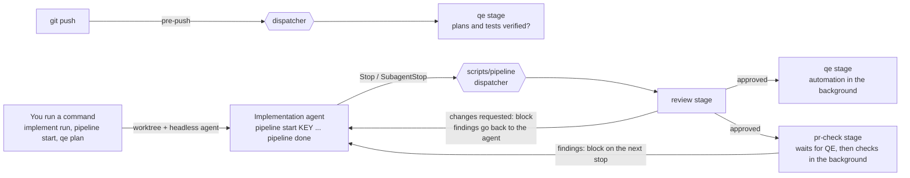
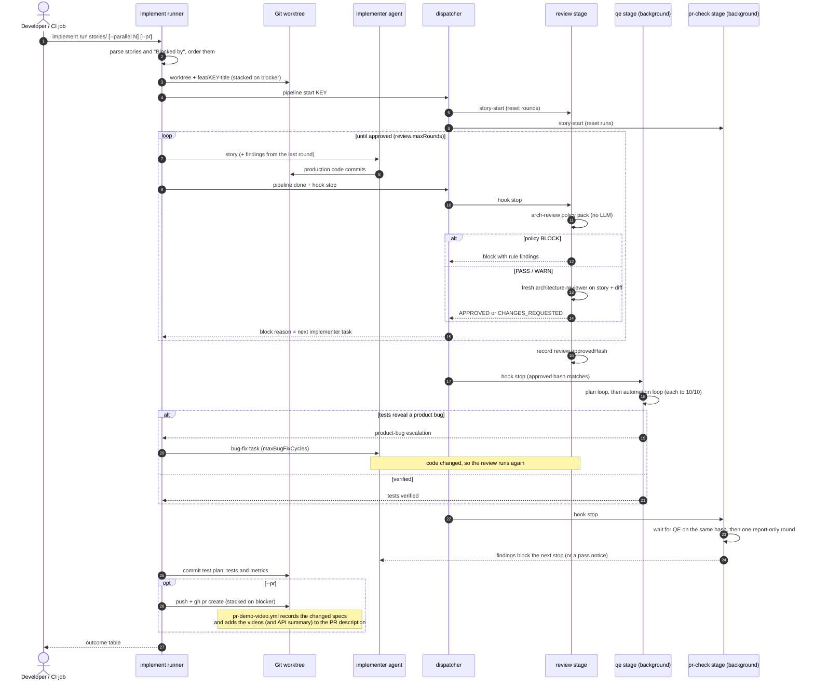
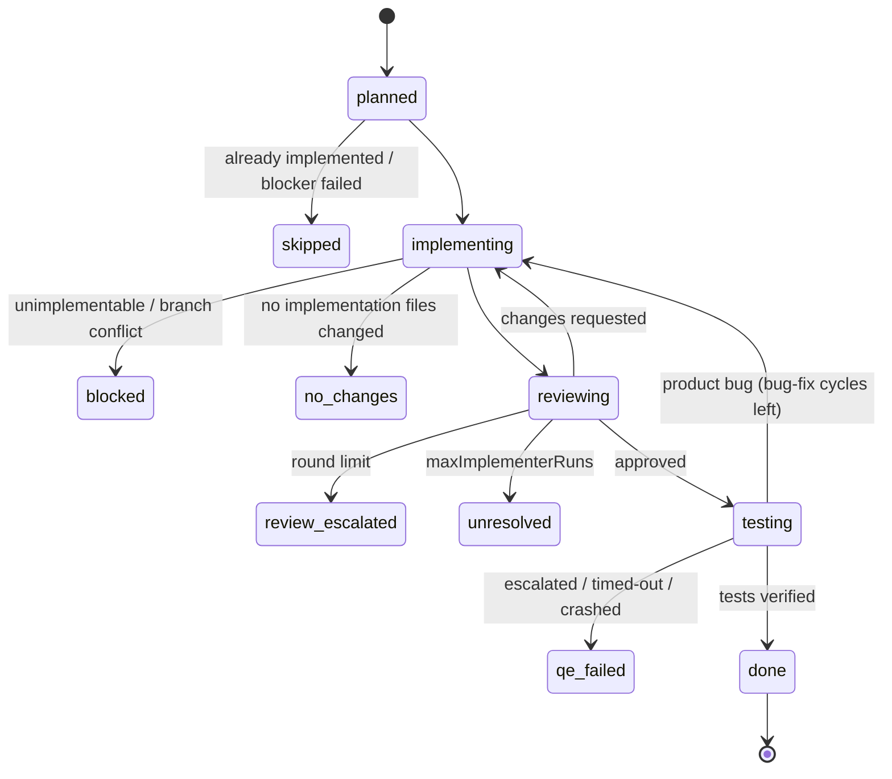

# AI development pipeline

Agents take a user story from implementation to reviewed code with verified tests. The pipeline is a set of independent **stages**, each with its own CLI, config, tests and docs, tied together by one **dispatcher** that every agent tool and git hook calls.

| Stage | Folder | What it does | Docs |
| --- | --- | --- | --- |
| `implement` | `scripts/implement/` | Implements every story in a folder headlessly: a worktree and branch per story, the implementer as orchestrator planning up to four subtasks for verifier pairs (implementer + fresh verifier per subtask, each in its own worktree, merged back by a Node harness), then the review and QE stages below | [implement.md](implement.md) |
| `review` | `scripts/review/` | Architecture review of the implementation by a fresh reviewer, looping with the implementation agent until approved | [review.md](review.md) |
| `qe` | `scripts/qe/` | Story to verified test plan (workflow 1); approved implementation to verified automated tests (workflow 2) | [qe.md](qe.md) |
| `pr-check` | `scripts/pr-check/` | Adversarial critics, defender and judge score the work against its story (acceptance criteria, flow, UI design, style, video evidence). From the Stop hook, once QE has verified the tests, it reports and the agent fixes; on demand, a fixer loops it to 10/10 | [pr-check.md](pr-check.md) |
| `board` | `scripts/board/` | Keeps the story's card on the GitHub Project board in step (In Progress, Pending Review with evidence) and picks up the stories assigned to you | [board.md](board.md) |

Pull requests also get a generated section in their description, written in CI by `.github/workflows/pr-demo-video.yml` (`scripts/pr-video/`, [pr-demo-video.md](pr-demo-video.md)):

- **Demo video**, for PRs that change the frontend: the videos of the e2e specs the PR adds or changes, recorded on the test stack.
- **API changes**, for PRs that change only the backend: one entry per HTTP endpoint the PR adds, changes or removes. Each entry gives the method and route (from the route-mapping diff), the request parameters and body, the responses (from the stack's OpenAPI documents) and example calls recorded from the PR's specs (`E2E_API_LOG=1`), with secrets redacted.

Stages run in the order listed in `scripts/pipeline/stages.json`. All of them are Node 20 scripts with no dependencies, and they drive a headless agent CLI: Claude Code by default, or Copilot CLI or Codex (`PIPELINE_AGENT_CLI=copilot|codex`), or any command (`PIPELINE_AGENT_CMD`, prompt on stdin).

| Guide | For |
| --- | --- |
| [setup.md](setup.md) | prerequisites and first-time setup, locally or on a CI runner |
| [writing-stories.md](writing-stories.md) | story authors: the file format and sections the agents rely on |
| [agents.md](agents.md) | every agent: what starts it, what it sees, its access, model and lessons |
| [escalations.md](escalations.md) | what to do when a story fails or a loop escalates to a human |



## Implementing a folder of stories

```bash
node scripts/pipeline/pipeline.mjs implement run product-research/stories --dry-run   # order, branches, bases
node scripts/pipeline/pipeline.mjs implement run path/to/stories [--parallel 2] [--pr]
node scripts/pipeline/pipeline.mjs implement status
node scripts/pipeline/pipeline.mjs implement resume                    # after a crash: continue the last run
```

Each story gets its own worktree and branch; the implementer plans it into subtasks that verifier pairs implement and check in their own worktrees, then the architecture review loop and verified tests run. A story "Blocked by" another story in the folder runs after it, stacked on its branch. See [implement.md](implement.md).

## Story board

Every story has an issue on the [eShop Story Board](https://github.com/users/armandodollia-slalom/projects/1) (Backlog, Ready, In Progress, Pending Review, Failed, Done). Stories wait in Backlog until they are ready; assign one to yourself, move it to Ready and run the picker on your machine; it runs the whole pipeline and moves the card as it goes, to Failed (with the reason and findings) when it cannot finish. See [board.md](board.md).

```bash
node scripts/board/board.mjs pick            # implement the stories assigned to you, polling the board
```

### One story, end to end



How a story reaches its [outcome](implement.md#outcomes):



## Using it as an implementation agent

When you (or an agent you drive yourself) implement a story by hand instead:

```bash
node scripts/pipeline/pipeline.mjs start PROMO-3   # begin a story (or work on a branch named after it)
node scripts/pipeline/pipeline.mjs done            # line of work complete: the stages run when the turn ends
node scripts/pipeline/pipeline.mjs status [PROMO-3]
```

`start` records the active story and tells each stage (the review resets its rounds, the PR check its runs). `done` marks the work complete; nothing reviews or tests the work until then, so an agent can stop mid-story without triggering anything.

## Lifecycle events

| When | Hook | Dispatcher call | Stages | Cost |
| --- | --- | --- | --- | --- |
| `pipeline start` | (command) | `story-start` | review, qe, pr-check, board (card to In Progress) | none |
| Any agent tool call | `PreToolUse` (Gemini `BeforeTool`) | `hook pre-tool` | story guard (see below) | none |
| Agent session start/resume | `SessionStart` | `hook session-start` | implement, review, qe, pr-check | none |
| Agent turn ends | `Stop` and `SubagentStop` | `hook stop` | review, then qe, then pr-check, then board (Pending Review) | LLM, only after `pipeline done` |
| Commit or merge | `.githooks/post-commit`, `.githooks/post-merge` | `git-hook post-commit\|post-merge` | qe, only with `git config qe.autoPlan true` (plans for changed stories, in the background) | LLM if opted in |
| Push | `.githooks/pre-push` | `git-hook pre-push` | qe (existing plans and tests for touched stories are verified and current) | none |
| Pull request | `.github/workflows/ai-pipeline.yml` | tests, then each stage's reusable workflow (`qe-check.yml`) | all | none |
| Pull request opened or pushed | `.github/workflows/pr-demo-video.yml` | `pr-video.mjs specs`, test stack + changed specs, `pr-video.mjs publish`, `pr-video.mjs api` ([demo videos](pr-demo-video.md)) | none | none |
| Manual (local, or `workflow_dispatch`) | `.github/workflows/qe-lessons.yml` | `qe calibrate`, `metrics`, `lessons` (opens a PR) | qe | LLM |

No agent starts on its own when stories or epics are added or changed: agent work starts only from a command (`implement run`, `pipeline start`, `qe plan`, `qe automate`) or from `pipeline done` in a session you started. `scripts/setup.sh` already points `core.hooksPath` at `.githooks`. `PIPELINE_DISABLE=1` turns every hook off. Agents spawned by the pipeline run with `PIPELINE_CHILD=1`, so their own Stop hooks and git hooks do nothing and cannot recurse. Stage-specific switches (for example `QE_SKIP=1 git push`, `git config qe.autoPlan true`) are listed in each stage's docs.

## Safety rails

| Rail | What it prevents |
| --- | --- |
| Fresh, read-only reviewers and verifiers | an agent grading its own work or seeing the producer's reasoning |
| Round limits and escalations (`.agent-state/escalations/`) | endless loops; hard decisions go to a human |
| Approved-hash gating | testing or PR-checking code that changed after the review |
| Script-computed PR check scores | an agent arguing its way to 10/10 |
| [Story guard](#story-guard) | agents reading stories, epics and mockups they were not given |
| `PIPELINE_CHILD=1` | spawned agents re-triggering hooks recursively |
| `pre-push` hook and CI | unverified plans or tests reaching the remote |
| Lessons via pull request | unreviewed changes to agent behavior |
| `PIPELINE_DISABLE=1`, `QE_SKIP=1`, `PR_CHECK_SKIP=1` | escape hatches for humans |

## Story guard

Agents ignore the story and epic folders (`storyGuard.folders` in `scripts/pipeline/config.json`, by default `product-research/`) except for what was handed to the pipeline:

- the story given to `pipeline start <KEY>` (recorded in `.agent-state/active-story`), and
- the folders or files given to `pipeline implement run`, passed to every worker and agent it starts as `PIPELINE_STORY_SOURCES`.

`hook pre-tool` denies any other read, search, listing, edit or shell command that names a path in those folders, including for agents the pipeline starts (`PIPELINE_CHILD=1`); only `PIPELINE_DISABLE=1` lifts it. The QE and review agents get their story text in the prompt, so they never need the folder, and the session-start context names only the active story. `product-research/` is also in `.graphifyignore`, so `graphify query` cannot surface it. A recursive search of the whole repo (for example `grep -r Coupon .`) does not name the folder and can still reach it; the instructions in `AGENTS.md` and its siblings cover that case. Humans are not affected: the guard is an agent hook only. To let an agent write or groom stories, start it with `PIPELINE_DISABLE=1` or set `storyGuard.enabled` to `false` in your copy of the config.

## The dispatcher

`scripts/pipeline/pipeline.mjs` runs each stage's CLI as a separate process, so a stage that crashes cannot take down the others or the agent.

- **Stop:** stages run in order with the hook payload on stdin. A stage prints nothing, a `systemMessage`, or a Claude-format `{"decision": "block", "reason": ...}`. The first block ends the dispatch, so later stages run only once earlier gates pass; that is how automation waits for the review. Messages are joined. A stage that fails becomes a message, never a broken turn.
- **SessionStart:** each stage prints plain text. The dispatcher adds the active story and open escalations, joins the text and wraps it once: top-level `additionalContext` (Copilot reads only this) plus `hookSpecificOutput` (Claude Code, Cursor). `--nested` emits only the nested form, for Codex, which rejects unknown keys.
- **Git hooks:** stage output goes straight to the terminal. Only `pre-push` can fail, and it fails if any stage fails.
- **`status` and `metrics`:** each stage's own command, grouped by stage (`metrics --json` returns `{ "<stage>": ... }`).

## Agent tool coverage

`.claude/settings.json` is the single source of truth for agent hooks: the dispatcher's `SessionStart`, `Stop` and `SubagentStop` hooks, the story guard (`PreToolUse`, every tool), and the graphify `--strict` guard that denies the first raw grep or file read until `graphify query` has run. Several tools load that file themselves, so they get no file of their own; adding one would run every hook twice.

| Tool | Hook file | Covers | Trust step |
| --- | --- | --- | --- |
| Claude Code | `.claude/settings.json` | all | accept the project's hooks when prompted |
| GitHub Copilot CLI and VS Code agent | `.claude/settings.json` (loaded alongside `.github/hooks/`) | all | add the repo to `trustedFolders` in `~/.copilot/config.json` |
| Cursor | `.claude/settings.json` (third-party hooks, on by default) | all; Cursor has no `Glob` hook | leave Cursor's third-party (Claude) hooks setting on, the default |
| Windsurf / Devin | `.claude/settings.json` | pipeline hooks; the graphify guard matchers don't match its lowercase tool names, so the guard is advisory via `AGENTS.md` | none |
| OpenAI Codex | `.codex/hooks.json` | all; the graphify check and the story guard cover `Bash` only, Codex's only search tool | trust the project, then approve the hooks in `/hooks` |
| Gemini CLI | `.gemini/settings.json` via `scripts/hooks/gemini-adapter.mjs` | all, `AfterAgent` stands in for `Stop` (no subagent hook) | approve the project hooks when prompted |

`gemini-adapter.mjs` translates Gemini's hook payload and output contract to Claude's, so Gemini runs the same commands.

Not covered: the Copilot cloud agent (its sandbox has no `graphify` or agent CLIs, and a `.github/hooks/` file would duplicate every hook in Copilot CLI), and Cline, Kiro and OpenCode (no way for a hook to block a turn from ending). For those, the git hooks and CI still enforce the stage checks.

## Agent definitions for Copilot and Claude Code

`.github/agents/<name>.agent.md` is the single source for every agent, including `implementer`. Copilot reads it directly, and the stages build their prompts from it. `scripts/sync-agents.mjs` renders each one to `.claude/agents/<name>.md`, so you can run the same agent from Claude Code. The generated copies add Claude-only settings from `scripts/agents-claude.json` (read-only tools for the reviewer and the verifiers, `isolation: worktree` for the implementer) and tell the agent to read its lessons file.

- Edit only `.github/agents/`, then run `npm run agents:sync`.
- If you write a new agent in `.claude/agents/`, `npm run agents:sync` moves it into `.github/agents/` and moves its Claude-only frontmatter to `scripts/agents-claude.json`.
- CI (`npm run agents:check`) fails when the two folders differ.

Every agent ends its final message with `AGENT_RESULT: {json}`, which the stage parses.

## Shared code and state

`scripts/pipeline/lib/` holds what every stage uses: config loading, git helpers, story lookup, per-story state, escalations, the agent runner and background runs.

- **Config:** `scripts/pipeline/config.json` (directories, base ref, agent CLI and default model, which paths count as implementation) is merged with the stage's own `scripts/<stage>/config.json`. Environment overrides: `PIPELINE_AGENT_CLI`, `PIPELINE_AGENT_CMD`, `PIPELINE_BASE_REF`, `PIPELINE_ROOT`.
- **State:** `.agent-state/` (not committed) holds the active story, one `stories/<KEY>.json` per story with a section per stage, locks, background logs (`logs/`) and escalations (`escalations/<KEY>-<stage>.md`, which the next agent session is told about).
- **Recovery:** every stage survives a crash, kill or reboot. Its runs record their pid and the boot they started in, and hold a lock for the whole run, so a pid reused after a reboot is never mistaken for the run. A run that died is found on the next session start or Stop hook, or by `pipeline resume`, and continues from its last saved round. The shared rules are in `scripts/pipeline/lib/recovery.mjs`: each run is retried `recovery.maxAttempts` times (default 3), waiting `recovery.backoffSec` (60 s) and then twice as long each time, then escalated; `pipeline resume <KEY> --force` restarts an escalated run.

  | Stage | What is saved | Picked up by |
  | --- | --- | --- |
  | implement | the batch (`batch.json`) and each story's progress; an orchestrated story's subtask worktrees | announced at session start; `pipeline resume` restarts the batch in the background; a resumed orchestrated story cleans up its subtask worktrees and continues without planning again ([implement](implement.md#interrupted-runs)) |
  | review | the round in progress (`review.inProgress`) | the next Stop reruns the round ([review](review.md#interrupted-reviews)) |
  | qe | plan and automation round and feedback | session start, Stop, `pipeline resume` ([qe](qe.md#crash-recovery)) |
  | pr-check | Stop-hook waiter in the story state; manual runs in `progress.json` after each critique and fix | session start, Stop, `pipeline resume` ([pr-check](pr-check.md#interrupted-checks)) |
  | lessons and factory retro (`qe lessons`) | `lessons-run.json`: phase, branch and process | the next `qe lessons`, session start, `pipeline resume` ([qe](qe.md#crash-recovery)) |

- **Metrics:** `.agent-metrics/*.jsonl` (committed; `merge=union` keeps every record across branches). Each stage owns its files. `decisions.jsonl` is shared: every stage records why its agents decided what they did (the implement orchestrator its plans, escalations and pair verdicts) (`scripts/pipeline/lib/decisions.mjs`, see [qe](qe.md#decision-log)), and the weekly lessons run turns it into lessons and proposed factory changes. `token-usage.jsonl` is also shared: every agent run's tokens, models, cache hits and cost, reported per ticket and epic by `pipeline costs` (see [costs](costs.md)).

## Adding a stage

1. Create `scripts/<stage>/<stage>.mjs` using the shared lib (`loadConfig('<stage>')`, `runMain`, `readPayload`). Implement the events it needs: `hook stop` (print nothing, a `systemMessage`, or a block), `hook session-start` (print plain text), `hook story-start <KEY>`, `git-hook <event>` (exit nonzero only on `pre-push` to fail the push), plus `status [story]` and `metrics [--json]`. A stage whose runs can be cut short also implements `resume [story] [--force] [--background]` and lists it in `commands`: it restarts its runs that died, in the background, and returns at once (`pipeline resume` calls every stage in turn). Use `runDied` and `nextAttempt` from `scripts/pipeline/lib/recovery.mjs` so every stage retries and escalates the same way.
2. Add it to `scripts/pipeline/stages.json` in the right order, listing its `hooks`, `gitHooks` and `commands`. A stage that must wait for another reads that stage's section of the story state (as `qe` reads `review.approvedHash`).
3. Put its tests in `scripts/<stage>/test/`; `npm run test:pipeline` and CI pick them up. For a PR gate, add a reusable workflow and call it from `ai-pipeline.yml`.
4. Document it in `docs/ai-pipeline/<stage>.md` and add it to the table above. No agent tool config changes are needed.

## Commands

```bash
node scripts/pipeline/pipeline.mjs start|done|status [KEY]
node scripts/pipeline/pipeline.mjs resume [KEY] [--force]       # continue every stage's runs that died (crash, kill, reboot)
node scripts/pipeline/pipeline.mjs implement [run] <KEY|dir|story.md>... [--parallel N] [--base <ref>] [--pr] [--force] [--dry-run]
node scripts/pipeline/pipeline.mjs implement resume [--parallel N] [--pr]
node scripts/pipeline/pipeline.mjs implement status [KEY]
node scripts/pipeline/pipeline.mjs stages
node scripts/pipeline/pipeline.mjs metrics [--json] [--since 2026-01-01]
node scripts/pipeline/pipeline.mjs costs [KEY] [--epic <epic>] [--since <date>] [--json|--markdown]  # tokens, cache hits and cost per stage, ticket and epic
node scripts/pipeline/pipeline.mjs hook stop|session-start [--nested]|pre-tool
node scripts/pipeline/pipeline.mjs git-hook post-commit|post-merge|pre-push
node scripts/pr-check/pr-check.mjs run --pr 42 [--no-fix]   # adversarial PR check until 10/10
node scripts/pr-video/pr-video.mjs specs|backend|publish|api|cleanup  # PR demo videos and API summary (pr-demo-video.yml)
node scripts/board/board.mjs setup|pick|mine|move|review|status   # see board.md
npm run test:pipeline                     # dispatcher and stage tests (fake agent, no LLM)
```
