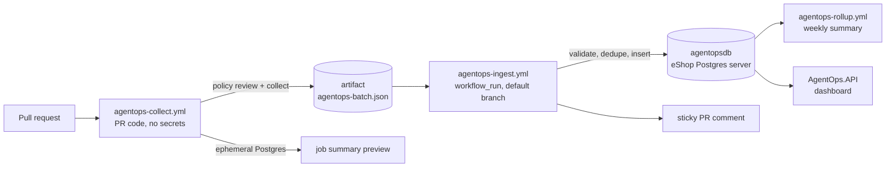

# AgentOps: pipeline-agent mistake tracking

AgentOps records the mistakes that the pipeline's **producing agents** make on each pull request and reports them per PR, per agent and over time. It stores them in its own database, `agentopsdb`, on the same Postgres server as the eShop services.

It tracks only the pipeline agents: `implementer`, `qe-plan` and `qe-automation`. The reviewers and verifiers are the source of the data, not the subject.

## What it records

| Source (`.agent-metrics/` or PR check) | Review run for | Mistakes |
| --- | --- | --- |
| `arch-reviews.jsonl`, written by the [review stage](review.md) | `implementer`. The source is the reviewer (`arch-review-agent` or `architecture-reviewer`). | One per finding, keyed by policy rule (for example `DATA-002`), otherwise by category |
| `verifier-runs.jsonl` ([qe stage](qe.md)) | the stage's producer (`plan` → `qe-plan`, `automation` → `qe-automation`) | none |
| `verifier-denials.jsonl` | linked to its verifier run | One per gap, attributed to `attributed_agent` and keyed `category/subtype` |
| `precheck-failures.jsonl` | the stage's producer, source `precheck` | One per error |
| Final Policy Pack review of the whole PR (`agentops-collect.yml`) | The agent named by an `agent:<name>` PR label, otherwise `implementer` if the implementer reviewed this PR | One per failed BLOCK/WARN action item, source `policy-final`. These are mistakes that **escaped** the in-loop gates. |

Only the JSONL lines that the PR **adds** are collected. Every event gets a deterministic id (a SHA-256 of its content), so re-running a workflow never double-counts. `calibration.jsonl` is not ingested, because it measures the verifiers.

## Reports

- **Per PR:** a sticky PR comment and the job summary. Each agent's rounds to approval and mistakes are grouped by key. Each group shows how many earlier PRs had the same mistake, marked "(repeat)".
- **Rollup:** generated weekly (`agentops-rollup.yml`), on demand (`dotnet run --project src/AgentOps.Cli -- report rollup --days 30`), or from the dashboard. It contains:
  - per agent: PRs, **first-pass rate** (the share of review series whose first run passed), **average rounds to approval**, mistakes, blocking mistakes and **escaped** mistakes;
  - **repeat mistakes**: the same agent with the same key in at least 2 PRs. These are the candidates for agent lessons;
  - **hotspots**: the files with the most mistakes.
- **Dashboard:** `AgentOps.API` serves the dashboard at `/` and read-only JSON at `/api/agentops/{summary,prs,prs/{number},mistakes}?api-version=1.0`.

## Data flow



The collect workflow runs untrusted PR code, so it has no secrets. The ingest workflow always runs from the default branch, and it treats the artifact as untrusted input. The CLI (`BatchSanitizer`) checks the schema and PR number, drops non-pipeline agents and malformed ids, truncates text and strips control characters before writing. Reports escape every PR-sourced string. The comment is posted only if the PR's head is still the commit that was collected.

## Components

| Path | Role |
| --- | --- |
| `src/AgentOps.Data` | EF Core model (`agentops` schema: `agents`, `pull_requests`, `review_runs`, `mistakes`, `ingest_batches`), migrations, the collector, the sanitizer, the ingester and the reports |
| `src/AgentOps.Cli` | `collect`, `ingest` and `report pr\|rollup` commands for CI. It reads `ConnectionStrings__agentopsdb`. |
| `src/AgentOps.API` | Internal read-only API and dashboard. It applies migrations at startup. |
| `src/eShop.AppHost` | `AddAgentOps` adds `agentopsdb` to the shared `postgres` server and runs `agentops-api` with no external endpoint. TestStack mode leaves it out. |
| `tests/AgentOps.UnitTests` | Collector, sanitizer, dedupe, metrics and Markdown escaping |

## Running locally

`aspire run` (or `dotnet run --project src/eShop.AppHost`) starts `agentops-api` next to the shop. Open it from the Aspire dashboard. To load a batch by hand:

```bash
export ConnectionStrings__agentopsdb="Host=localhost;Port=<postgres port>;Database=agentopsdb;Username=postgres;Password=<from the Aspire dashboard>"
dotnet run --project src/AgentOps.Cli -- ingest --batch agentops-batch.json
dotnet run --project src/AgentOps.Cli -- report pr --number 123
```

## Azure setup (shared eShop Postgres server)

1. Create the database and a least-privilege role that can reach only `agentopsdb`:

   ```sql
   CREATE DATABASE agentopsdb;
   CREATE ROLE agentops_writer LOGIN PASSWORD '<generated>';
   REVOKE ALL ON DATABASE agentopsdb FROM PUBLIC;
   GRANT CONNECT, CREATE ON DATABASE agentopsdb TO agentops_writer;
   ```

   The CLI applies migrations, so the role owns the `agentops` schema it creates. It has no rights on `catalogdb`, `orderingdb` or the other service databases.
2. Make the server reachable from GitHub Actions. The `postgres` resource that Aspire deploys to Azure Container Apps is internal-only by default. Choose one option:
   - expose TCP ingress restricted to the [GitHub Actions IP ranges](https://api.github.com/meta);
   - use a self-hosted runner in the Container Apps environment's virtual network;
   - move the server to Azure Database for PostgreSQL Flexible Server with a firewall rule.

   Require TLS (`SSL Mode=Require`).
3. Add the repository secret `AGENTOPS_DB` with the connection string, for example `Host=<host>;Port=5432;Database=agentopsdb;Username=agentops_writer;Password=<generated>;SSL Mode=Require`.

Without `AGENTOPS_DB`, ingest uses a throwaway Postgres container. The PR comment then covers only that PR, with no history, and the rollup is skipped.
