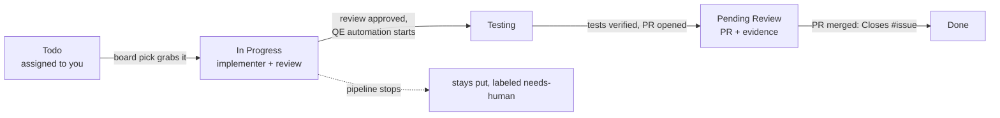

# Board stage

Part of the [AI development pipeline](README.md). Every story in `product-research/stories/` is an issue on the **[eShop Story Board](https://github.com/users/armandodollia-slalom/projects/1)**, a GitHub Project with a Board view. Assign a story to yourself and your local picker runs the pipeline for it, moving the card as the work moves.

The stage CLI is `scripts/board/board.mjs`; settings are in `scripts/board/config.json`.



| Column | Moved by |
| --- | --- |
| Todo | `board setup` (new stories), or you (`board move <KEY> todo --force`) to retry |
| In Progress | `board pick` when it grabs the story; also `pipeline start <KEY>` (story-start hook) |
| Testing | the Stop hook, once the review approves and QE automation is running |
| Pending Review | `pipeline implement --pr` after it opens the PR (headless); the Stop hook once tests are verified (interactive sessions, no PR) |
| Done | `board pick`, on every poll: story issues that are closed move to Done. The PR body gets `Closes #<issue>`, so merging the PR closes the issue. (The project's built-in "Item closed" workflow does the same instantly if you turn it on under the project's Workflows; GitHub has no API for that.) |

Hooks only move a card forward, so a replayed hook never drags a card back. The board is informational: GitHub errors are logged and never block an agent or change a pipeline outcome.

## Picking up your stories

```bash
node scripts/board/board.mjs mine                # stories assigned to you (gh's logged-in user)
node scripts/board/board.mjs pick --dry-run      # what would be picked up
node scripts/board/board.mjs pick                # poll every 2 minutes; Ctrl-C to stop
node scripts/board/board.mjs pick --once --parallel 2
```

The picker takes open story issues in **Todo**, assigned to you, without the `needs-human` label. It claims each card (In Progress plus a comment naming your machine) before running `pipeline implement run <stories> --pr`, so a second poll or machine never picks the same story. If a story does not finish (`blocked`, `unresolved`, `qe-escalated`, already implemented, no story file on this checkout, ...), the picker comments the outcome, reason, branch and log path, and adds `needs-human`. Fix it, remove the label and move the card back to Todo to retry.

Run the picker from an up-to-date checkout of `main`: it reads the story files locally and `pipeline implement` bases each branch on `origin/main`.

## Pending Review evidence

When a story reaches Pending Review, the issue gets a comment with the PR link and:

- **API stories** (`[BE - ...]` in the title): the requests and responses of the story's verified Playwright tests. The stage re-runs the tests whose names carry the story's case ids (`TC-<KEY>-`) against the test stack with tracing on, reads the API calls from each trace, and posts them grouped by test case. Secrets (`token`, `password`, `secret`, ... keys) are redacted, bodies and the comment are capped (`evidence` in the config), and the full log stays in `.agent-state/evidence/<KEY>/api-evidence.md`. Stories with only .NET tests point to the PR instead. The test stack must be up (`testing/teststack up`), as it is for QE.
- **UI stories** (`[FE - ...]`): the feature video. **TODO:** PR videos are being added separately; until then the comment says the video is pending. When that lands, `featureVideo()` in `scripts/board/lib/evidence.mjs` returns the PR's video URL and the ticket links the same recording.

## Setup

One-time, already done for this repo (project #1). Run it again after adding stories; it is idempotent.

```bash
gh auth refresh -s project                       # Projects need the project scope
node scripts/board/board.mjs setup
```

`setup` enables issues on the repo, creates the labels (`story`, `needs-human`, `frontend`, `backend`), creates and links the project (saving its number in `scripts/board/config.json`), sets the Status columns, adds a Board view, and creates an issue for every story without one (title from the story's heading, body with the story text and a link to the file) in Todo. Any repo collaborator can be assigned.

The board is active only when `scripts/board/config.json` has a `projectNumber`, the checkout's `origin` is the configured repo (so test fixtures and forks never touch it), and `PIPELINE_BOARD` is not `0`. Everyone who runs the picker or the hooks needs `gh` logged in with the `project` scope.

## Commands

```bash
node scripts/board/board.mjs setup
node scripts/board/board.mjs pick [--once] [--parallel N] [--interval <sec>] [--dry-run]
node scripts/board/board.mjs mine
node scripts/board/board.mjs move <KEY> todo|inProgress|testing|review|done [--force]
node scripts/board/board.mjs review <KEY> [--pr <url>]   # Pending Review + evidence by hand
node scripts/board/board.mjs status [KEY]
node scripts/board/board.mjs hook story-start <KEY> | hook stop   # called by the dispatcher
npm run test:pipeline
```
