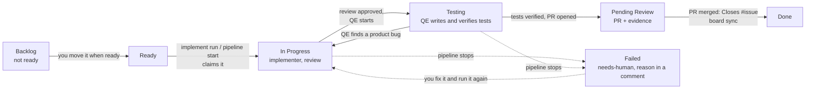

# Board stage

Part of the [AI development pipeline](README.md). Every story in `product-research/stories/` is an issue on the **[eShop Story Board](https://github.com/users/armandodollia-slalom/projects/1)**, a GitHub Project whose default view shows the epics. An engineer starts the pipeline by hand for a story or a whole epic, and the card moves as the pipeline reaches each step: claimed, under test, back to the implementer on a product bug, ready for review, failed or done.

The stage CLI is `scripts/board/board.mjs`; settings are in `scripts/board/config.json`. The state machine is `scripts/board/lib/flow.mjs`.



## Lanes

| Lane | Reached by |
| --- | --- |
| Backlog | `board setup` (new stories). Not ready for implementation |
| Ready | you, when a story is ready for implementation |
| In Progress | the **claim** when `pipeline implement run` (or an interactive `pipeline start <KEY>`) begins the story, with a comment naming the user and machine; and the **product-bug** event when QE finds bugs in the implementation and the story goes back to the implementer, with a comment listing the bugs |
| Testing | the **testing** event: the architecture review approved the code and QE started writing and verifying the automated tests (again after every bug fix) |
| Pending Review | the **verified** event: the tests are verified and the PR is open (headless), or the line of work is done and verified (interactive, no PR). The issue gets the review notes and evidence; the epic gets the same links |
| Failed | the **failed** event: any outcome of `pipeline implement run` other than done (`blocked`, `unresolved`, `plan-rejected`, `pair-exhausted`, `limit-*`, `qe-*`, a blocker that failed, a PR that could not be opened, ...). The card gets the `needs-human` label and a comment with the outcome, reason, findings, branch and log path |
| Done | `board sync`: closed story issues move to Done. The PR body gets `Closes #<issue>`, so merging the PR closes the issue. (The project's built-in "Item closed" workflow does the same instantly if you turn it on under the project's Workflows; GitHub has no API for that.) |

The board is informational: GitHub errors are logged and never block an agent or change a pipeline outcome.

## The state machine

Pipeline events move a card only along these transitions; any other event is ignored and logged.

| Event | Sent by | From | To |
| --- | --- | --- | --- |
| `claim` | `implement run` (each story it runs), `pipeline start` (story-start hook) | no lane, Backlog, Ready, Failed, In Progress; Testing, Pending Review or Done only with `--force`; a card another machine holds only with `--takeover` | In Progress |
| `testing` | the runner after the review approves; the Stop hook (interactive) | In Progress | Testing |
| `product-bug` | the runner when QE reports bugs and a bug-fix cycle starts; the Stop hook | Testing, In Progress | In Progress |
| `verified` | the runner after it opens the PR (`board review`); the Stop hook | In Progress, Testing | Pending Review |
| `failed` | `implement run` for every story that did not finish (`board fail`) | no lane, Backlog, Ready, In Progress, Testing | Failed |
| `closed` | `board sync` | any lane but Done | Done |

Testing goes back to In Progress only on a product bug. A claim of a card in Testing by the machine that holds it (a resumed run) leaves it in Testing.

**Claims.** A claim fails when the card is in In Progress or Testing and its latest event came from another user or machine (`<gh login>@<host>`). `implement run` then skips that story (and any story stacked on it) and says who holds it; `--takeover` takes it over (`--force` is for running a story in Pending Review or Done again). While another machine holds a card, events from this machine are ignored (`not-owner`), so a stale run cannot move a card someone else took over.

**Sequence numbers.** Every event carries a per-ticket number that only grows. The last applied number is stored in two places:

- on this machine, in `<git common dir>/ai-pipeline/board/<KEY>.json` (shared by the main checkout and every worktree, so the batch and its story workers agree), with the number each event id was given;
- on the card, in a hidden marker at the end of the comment each transition posts (`<!-- pipeline-board:{"seq":4,"owner":"me@host","event":"testing",...} -->`), so other machines see it.

An event whose number is not above the last applied one is stale or a replay and is ignored. Events carry ids derived from the pipeline state (`testing:<approved hash>`, `bug:<QE finish time>`, `verified:<verified hash>`), and an id keeps the number it was first given, so the runner and the Stop hook can report the same event any number of times and it applies once, in order.

**Moving cards by hand.** `board move <KEY> <lane>` moves a card forward in board order (Backlog, Ready, In Progress, Testing, Pending Review, Failed, Done); `--force` moves it anywhere. Hand moves bypass the state machine.

## Starting the pipeline

Automatic pickup (`board pick`, which polled the board and ran the stories assigned to you) was removed; it will be reworked later. An engineer starts the pipeline by hand from an up-to-date checkout of `main`:

```bash
node scripts/pipeline/pipeline.mjs implement run --epic promotions-and-recommendations --pr   # every story of an epic
node scripts/pipeline/pipeline.mjs implement run PROMO-3 --pr                                  # one story
node scripts/board/board.mjs mine                                                              # the stories assigned to you
```

`implement run` first runs `board sync`, then claims every story it will run. The headless runner reports `testing`, `product-bug` and `verified` from each story's worktree as they happen, and after the batch it moves every story that did not finish to Failed. Fix a failed story, remove the `needs-human` label and run it again (the claim takes it out of Failed), or move it back to Ready by hand (`board move <KEY> ready --force`).

**Interactive sessions.** `pipeline start <KEY>` claims the card (story-start hook; a card another machine holds is not taken: `board claim <KEY> --takeover` takes it). The board stage's Stop hook reads the story's pipeline state and reports, in order, a product bug QE found since the last stop, the review approving the code QE is now testing, and the verified tests of a finished line of work, so the card moves the same way as in a headless run. Headless runs (`PIPELINE_HEADLESS=1`) skip both hooks because the runner reports its own events.

## board sync

`board sync` does the bookkeeping that belongs to no single run. `implement run` runs it at start; run it by hand any time.

- Closed story issues move to Done, and their section on the epic's evidence comment shows Done.
- Their late outcome is recorded for the [implement decision log](implement.md#decision-log): whether the PR merged, how many commits and lines humans added on the branch before merge, and which BUG-* stories name the story (`type: "late"` in `.agent-metrics/decision-outcomes.jsonl` of the checkout, left uncommitted). Only stories this machine implemented have a run record to compare with.
- Every epic card moves to the lane its stories call for.

## Pending Review evidence

When a story reaches Pending Review, the issue gets a comment with the PR link and:

- **API stories** (`[BE - ...]` in the title): the requests and responses of the story's verified Playwright tests. The stage re-runs the tests whose names carry the story's case ids (`TC-<KEY>-`) against the test stack with tracing on, reads the API calls from each trace, and posts them grouped by test case. Secrets (`token`, `password`, `secret`, ... keys) are redacted, bodies and the comment are capped (`evidence` in the config), and the full log stays in `.agent-state/evidence/<KEY>/api-evidence.md`. Stories with only .NET tests point to the PR instead. The test stack must be up (`testing/teststack up`), as it is for QE.
- **UI stories** (`[FE - ...]`): the feature video. The PR demo video workflow adds the recording to the PR; until `featureVideo()` in `scripts/board/lib/evidence.mjs` returns its URL, the comment points to the PR.

## Epic evidence

Whenever a story posts evidence (Pending Review), fails, or reaches Done, its epic issue gets the same links on **one rolling comment**, edited in place and found by a hidden marker (`<!-- pipeline-epic-evidence:{...} -->`, which also carries the data, so any machine can update its story's section without losing the others). The comment has:

- per story: its lane, the PR link (and the epic branch it was merged into) or the branch, the feature video, screenshots, and a link to the API evidence comment on the story issue (the requests and responses themselves stay on the story issue);
- for an epic delivered as one branch: the epic PR, its branch and its video (`board epic-pr <epic issue> --pr <url> [--branch <name>] [--video <url>]`; `board review <KEY> --pr <url> --epic-branch <branch>` records that a story's PR was merged into the epic branch).

Over 60,000 characters every story shrinks to one line of links, below GitHub's comment limit.

## Epics and mockups

Every `product-research/epic-*.md` file gets an issue (label `epic`, title from its heading) and a card. Each story becomes a sub-issue of the epic its **Part of** line links to. The project's views, in tab order:

| View | Shows |
| --- | --- |
| Epics (default) | Epic cards only, with each one's sub-issue progress. Open an epic to see its stories and click through to them |
| Stories by epic | Story cards, one swimlane per epic (grouped by the built-in Parent issue field) |
| Stories | Story cards, no swimlanes |
| All items | Table of everything |

GitHub can't reorder views, so `setup` recreates them in this order if they drift (the view URLs change when it does).

An epic's lane follows its stories; the first rule that matches wins:

| Epic lane | When its stories are |
| --- | --- |
| Done | all done |
| Pending Review | all in Pending Review or Done |
| In Progress | any in progress |
| Testing | none in progress, any in testing |
| Failed | any failed, and none can still move on its own (none in progress, testing or ready) |
| Ready | any ready |
| In Progress | some in Pending Review or Done, the rest in Backlog |
| Backlog | otherwise |

Every story transition, `board sync` and `setup` recompute it, so moving an epic card by hand is undone.

**Assigning an epic assigns its stories.** The `board-epic-assign` workflow runs when an epic is assigned or unassigned, and `board sync-epic <issue>` gives every open story of the epic exactly the epic's assignees. A story can still be reassigned on its own afterwards; the next change to the epic's assignees overrides it. The workflow runs from the default branch, so it works once this lands on main; until then run `sync-epic` by hand.

Mockups live in `product-research/mockups/<owner>-<name>/`, where `<owner>` is a story key (`PROMO-2-promotions-admin`) or an epic file name (`epic-promotions-and-recommendations-...`). `setup` adds a **Mockups** section to the owner's issue: a link to the folder, the README's summary and live links, a link to every file, and images shown inline. An epic's issue also lists its stories' mockups. Add a folder and run `setup` again to attach it.

## Setup

One-time, already done for this repo (project #1). Run it again after adding stories or columns; it is idempotent.

```bash
gh auth refresh -s project                       # Projects need the project scope
node scripts/board/board.mjs setup
```

`setup` enables issues on the repo, creates the labels (`story`, `epic`, `needs-human`, `frontend`, `backend`), creates and links the project (saving its number in `scripts/board/config.json`), sets the Status columns, sets up the views, and creates an issue for every story without one (title from the story's heading, body with the story text and a link to the file) in Backlog. It also refreshes existing issue bodies when a story file changes, renames columns in place (Todo became Ready) and adds new ones without losing their cards. **Run `board setup` once after pulling the change that adds the Testing lane**: until then, moving a card to Testing is logged and skipped. Any repo collaborator can be assigned.

The board is active only when `scripts/board/config.json` has a `projectNumber`, the checkout's `origin` is the configured repo (so test fixtures and forks never touch it), and `PIPELINE_BOARD` is not `0`. Everyone who runs the pipeline needs `gh` logged in with the `project` scope.

## Commands

```bash
node scripts/board/board.mjs setup
node scripts/board/board.mjs sync                          # closed stories to Done, late outcomes, epic lanes
node scripts/board/board.mjs mine
node scripts/board/board.mjs claim <KEY>... [--force] [--takeover]  # claim for this machine (implement run does this)
node scripts/board/board.mjs event <KEY> claim|testing|product-bug|verified|failed|closed [--id <id>] [--force] [--takeover]
node scripts/board/board.mjs fail <KEY>                    # Failed + needs-human from the implement run record
node scripts/board/board.mjs move <KEY> backlog|ready|inProgress|testing|review|failed|done [--force]
node scripts/board/board.mjs review <KEY> [--pr <url>] [--epic-branch <branch>]   # Pending Review + evidence
node scripts/board/board.mjs epic-pr <epic issue> --pr <url> [--branch <name>] [--video <url>]
node scripts/board/board.mjs status [KEY]                  # lane and last event (number, owner)
node scripts/board/board.mjs sync-epic <issue>             # give an epic's open stories its assignees
node scripts/board/board.mjs hook story-start <KEY> | hook stop   # called by the dispatcher
npm run test:pipeline
```
