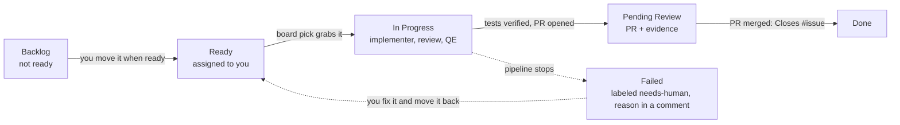

# Board stage

Part of the [AI development pipeline](README.md). Every story in `product-research/stories/` is an issue on the **[eShop Story Board](https://github.com/users/armandodollia-slalom/projects/1)**, a GitHub Project whose default view shows the epics. Assign a story (or a whole epic) to yourself and your local picker runs the pipeline for it, moving the card as the work moves.

The stage CLI is `scripts/board/board.mjs`; settings are in `scripts/board/config.json`.



| Column | Moved by |
| --- | --- |
| Backlog | `board setup` (new stories). Not ready for implementation: the picker never takes these, even when they are assigned |
| Ready | you, when a story is ready for implementation (`board move <KEY> ready --force` to retry a parked one) |
| In Progress | `board pick` when it grabs the story; also `pipeline start <KEY>` (story-start hook) |
| Pending Review | `pipeline implement --pr` after it opens the PR (headless); the Stop hook once tests are verified (interactive sessions, no PR) |
| Failed | `board pick`, when `pipeline implement` does not finish a story (`blocked`, `unresolved`, `plan-rejected`, `pair-exhausted`, `limit-*`, `qe-*`, no story file, ...). The card also gets the `needs-human` label and a comment with the outcome, reason, findings, branch and log path. The picker never takes cards from Failed; retry with `board move <KEY> ready --force` after removing the label |
| Done | `board pick`, on every poll: story issues that are closed move to Done. The PR body gets `Closes #<issue>`, so merging the PR closes the issue. (The project's built-in "Item closed" workflow does the same instantly if you turn it on under the project's Workflows; GitHub has no API for that.) |

Hooks only move a card forward, so a replayed hook never drags a card back. Failed sits after Pending Review in that order, so no hook (not even `pipeline start`) moves a card out of it; only a forced `board move` does. The board is informational: GitHub errors are logged and never block an agent or change a pipeline outcome.

## Picking up your stories

```bash
node scripts/board/board.mjs mine                # stories assigned to you (gh's logged-in user)
node scripts/board/board.mjs pick --dry-run      # what would be picked up
node scripts/board/board.mjs pick                # poll every 2 minutes; Ctrl-C to stop
node scripts/board/board.mjs pick --once --parallel 2
```

The picker takes open story issues in **Ready**, assigned to you, without the `needs-human` label. It claims each card (In Progress plus a comment naming your machine) before running `pipeline implement run <stories> --pr`, so a second poll or machine never picks the same story. If a story does not finish (`blocked`, `unresolved`, `plan-rejected`, `pair-exhausted`, `limit-*`, `qe-escalated`, already implemented, no story file on this checkout, ...), the picker moves the card to **Failed**, comments the outcome, reason, findings (for example the verifier findings of a pair that ran out of rounds), branch and log path, and adds `needs-human`. Fix it, remove the label and move the card back to Ready (`board move <KEY> ready --force`) to retry.

When the picker moves a closed story to Done, it also records the story's late outcome for the [implement decision log](implement.md#decision-log): whether its PR merged, how many commits and lines humans added on the branch before merge, and which BUG-* stories name it (`type: "late"` in `.agent-metrics/decision-outcomes.jsonl` of the checkout, left uncommitted).

Run the picker from an up-to-date checkout of `main`: it reads the story files locally and `pipeline implement` bases each branch on `origin/main`.

## Pending Review evidence

When a story reaches Pending Review, the issue gets a comment with the PR link and:

- **API stories** (`[BE - ...]` in the title): the requests and responses of the story's verified Playwright tests. The stage re-runs the tests whose names carry the story's case ids (`TC-<KEY>-`) against the test stack with tracing on, reads the API calls from each trace, and posts them grouped by test case. Secrets (`token`, `password`, `secret`, ... keys) are redacted, bodies and the comment are capped (`evidence` in the config), and the full log stays in `.agent-state/evidence/<KEY>/api-evidence.md`. Stories with only .NET tests point to the PR instead. The test stack must be up (`testing/teststack up`), as it is for QE.
- **UI stories** (`[FE - ...]`): the feature video. **TODO:** PR videos are being added separately; until then the comment says the video is pending. When that lands, `featureVideo()` in `scripts/board/lib/evidence.mjs` returns the PR's video URL and the ticket links the same recording.

## Epics and mockups

Every `product-research/epic-*.md` file gets an issue (label `epic`, title from its heading) and a card. Each story becomes a sub-issue of the epic its **Part of** line links to. The project's views, in tab order:

| View | Shows |
|---|---|
| Epics (default) | Epic cards only, with each one's sub-issue progress. Open an epic to see its stories and click through to them |
| Stories by epic | Story cards, one swimlane per epic (grouped by the built-in Parent issue field) |
| Stories | Story cards, no swimlanes |
| All items | Table of everything |

GitHub can't reorder views, so `setup` recreates them in this order if they drift (the view URLs change when it does).

An epic's lane follows its stories: Done when all are done, Pending Review when all are in review or done, In Progress once any has started, Ready once any is ready, else Backlog. `setup`, every `pick` poll and every card move keep it in step, so moving an epic card by hand is undone. Epics are never picked up.

**Assigning an epic assigns its stories.** The `board-epic-assign` workflow runs when an epic is assigned or unassigned, and `board sync-epic <issue>` gives every open story of the epic exactly the epic's assignees. A story can still be reassigned on its own afterwards; the next change to the epic's assignees overrides it. The workflow runs from the default branch, so it works once this lands on main; until then run `sync-epic` by hand.

Mockups live in `product-research/mockups/<owner>-<name>/`, where `<owner>` is a story key (`PROMO-2-promotions-admin`) or an epic file name (`epic-promotions-and-recommendations-...`). `setup` adds a **Mockups** section to the owner's issue: a link to the folder, the README's summary and live links, a link to every file, and images shown inline. An epic's issue also lists its stories' mockups. Add a folder and run `setup` again to attach it.

## Setup

One-time, already done for this repo (project #1). Run it again after adding stories; it is idempotent.

```bash
gh auth refresh -s project                       # Projects need the project scope
node scripts/board/board.mjs setup
```

`setup` enables issues on the repo, creates the labels (`story`, `epic`, `needs-human`, `frontend`, `backend`), creates and links the project (saving its number in `scripts/board/config.json`), sets the Status columns, sets up the views, and creates an issue for every story without one (title from the story's heading, body with the story text and a link to the file) in Backlog. It also refreshes existing issue bodies when a story file changes, renames columns in place (Todo became Ready) and adds new ones (Failed) without losing their cards. Run `board setup` once after pulling a change that adds a column; until then moving a card to the missing column is logged and skipped. Any repo collaborator can be assigned.

The board is active only when `scripts/board/config.json` has a `projectNumber`, the checkout's `origin` is the configured repo (so test fixtures and forks never touch it), and `PIPELINE_BOARD` is not `0`. Everyone who runs the picker or the hooks needs `gh` logged in with the `project` scope.

## Commands

```bash
node scripts/board/board.mjs setup
node scripts/board/board.mjs pick [--once] [--parallel N] [--interval <sec>] [--dry-run]
node scripts/board/board.mjs mine
node scripts/board/board.mjs move <KEY> backlog|ready|inProgress|review|failed|done [--force]
node scripts/board/board.mjs review <KEY> [--pr <url>]   # Pending Review + evidence by hand
node scripts/board/board.mjs status [KEY]
node scripts/board/board.mjs sync-epic <issue>   # give an epic's open stories its assignees
node scripts/board/board.mjs hook story-start <KEY> | hook stop   # called by the dispatcher
npm run test:pipeline
```
