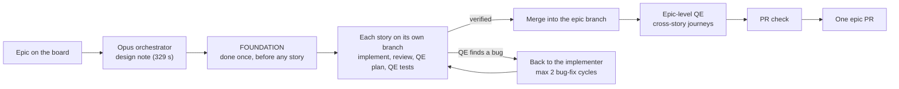

# First epic run of the AI pipeline: Promotions & Recommendations (in progress)

> **Status: in progress.** Numbers are from 2026-11-11 (UTC). PROMO-2 is still running, in its first bug-fix cycle, and PROMO-3 to PROMO-9 have not started. This page will be updated with the final numbers.

**The epic run took four attempts to get a story through the pipeline, and each failure was a path the pipeline had never run before, fixed generically. On the fourth attempt PROMO-2's automated tests found two real bugs in the implementation that the code reviewers had not.**

This follows the [PROMO-1 runs](demo-first-results.md), which took one story through the pipeline. Here the unit is the whole epic: `node scripts/pipeline/pipeline.mjs implement run --epic promotions-and-recommendations --pr`. Numbers come from the run's own logs and metrics.

## The flow

Epic delivery uses one branch, `epic/promotions-and-recommendations`. Each story gets its own branch and is merged into the epic branch once verified. QE then tests the journeys that cross stories, one PR check runs, and the run opens one epic PR.

Plan order: PROMO-1 (already merged as #98, skipped), PROMO-2, PROMO-3, PROMO-5, PROMO-4, PROMO-6, PROMO-7, PROMO-8, PROMO-9.

## The epic plan

The orchestrator wrote the design note in 329 s. Its key decision was a **foundation** to do once before any story. PROMO-2, PROMO-4 and PROMO-7 all need an admin, so the foundation adds:

- an `admin` role in Identity.API, issued as a role claim, with alice seeded as admin
- a `PromotionsAdmin` policy in Promotions.API
- an `Admin` policy in the WebApp

## Four attempts

| Attempt | What happened | Cause | Fix |
| --- | --- | --- | --- |
| 1 | Foundation failed | Adding the admin role rows to the default test-stack scenario broke an existing test (`PasswordsTests`, `Steps.Single()`). The fix was one line, but that test file was not in the foundation's allowed files (`owns`), so the agent stopped. | Added the file to `owns` in the design note. The rerun reused the note and the committed work. |
| 2 | Foundation failed 3 verifier rounds | "Outside owns" findings on `.agent-metrics/token-usage.jsonl` and `decisions.jsonl`, which the harness itself commits. The agent flagged this as a follow-up itself. | PR #104: scope checks ignore `.agent-metrics/`, `.agent-state/` and `graphify-out/` |
| 3 | Foundation approved in round 1 (175 s implement, 23 s verify). PROMO-2 was implemented, then its new migration was blocked. The rest of the epic was skipped behind it. | The Architecture Policy Pack's DATA-001 ("applied EF migrations are immutable") fired. The review sent changed files as a plain list, which the policy engine reads as "every file modified". This was the first run with the Policy Pack actually on; it used to be skipped because Python's `yaml` module was missing. | PR #108: send each file with its status (A, M or D). On PROMO-2's real diff, the plain list gave BLOCK (DATA-001) and the status map gave a WARN only. |
| 4 | Running (below) | | |

## PROMO-2 so far (attempt 4)

- **Implement.** PROMO-2's implementer was approved by its verifier in round 1.
- **Architecture review.** Approved.
- **QE plan.** Verified 9/10 in round 2 (round 1 was 8/10 with 5 gaps). 66 cases.
- **QE automation, round 1.** Found 2 **real implementation bugs**. TC-PROMO-2-22 and TC-PROMO-2-23 expect invalid targets (`{Brand, null}` and `{All, 5}`) to return 400 with errors keyed `targets`, but the validator keys them `targets[0].targetId`.
- **Bug-fix cycle 1 of 2.** The story went back to the Opus implementer, and the board moved card #53 from Testing back to In Progress.

## What we learned

1. **The pipeline catches real bugs, and the tests are what caught them.** The validation-key bug passed the implementer's verifier and the architecture review. The QE tests, written from the story, found it.
2. **Each failure was a first-time path, and a restart costs only the failed step.** A restart keeps the design note and the committed foundation, so the four attempts did not repeat finished work.
3. **The epic planner has to include the tests of whatever the foundation changes.** The foundation changed a shared test-stack scenario, which broke `PasswordsTests`. That file belongs in `owns`.
4. **Turning on a check can expose an integration bug that unit tests did not cover.** The Policy Pack had been skipped for as long as Python's `yaml` module was missing. Once it ran, it blocked a legitimate new migration because of how the review passed it the changed files.
5. **The harness's own commits are not the agent's scope.** The agent was blocked for files the harness writes.

## What's next

- **Finish PROMO-2.** The bug-fix cycle's result and the remaining automation rounds.
- **Run the rest of the epic.** PROMO-3, PROMO-5, PROMO-4, PROMO-6, PROMO-7, PROMO-8 and PROMO-9, in that order, plus epic-level QE, the PR check and the epic PR.
- **Planner: foundation tests.** Have the epic planner add the tests of whatever the foundation changes to its `owns`.
- **Final numbers.** Times, rounds, tokens and cost per story, once the run finishes.
