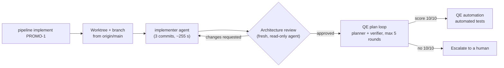

# First end-to-end run of the AI pipeline: PROMO-1

**Implementation and architecture review passed on the first attempt. The test plan did not, because the story was under-specified. The pipeline's own verifier showed exactly where.**

This is the first full trial of the [AI development pipeline](README.md) on a real story, [PROMO-1](../../product-research/stories/PROMO-1-promotions-service-scaffold.md) (the Promotions.API service scaffold for the eShop promotions and marketing features). Results below come from the run's own metrics and logs, recorded on 2026-11-10.

## The flow

One command starts it: `node scripts/pipeline/pipeline.mjs implement PROMO-1`. It creates a worktree and branch from `origin/main` and runs the `implementer` agent headless with hooks on. Everything after that is driven by hooks.

## Results

| Stage | Run 1 | Run 2 (after the fixes) |
| --- | --- | --- |
| Implement | 1 run, about 255 s, 3 commits: project, EF model, migration and seed; AppHost, Identity, WebApp and test stack wiring; story notes. Build and existing unit tests passed (agent's report). The stack was not run end to end. | Same three commits, rebased onto the fixed story |
| Architecture review | **Approved in round 1**, minor notes only (Swagger UI client not defined in Identity, seed not atomic, entities returned directly) | Approved in round 1, minor notes only |
| QE test plan | **Did not converge.** 10 verifier rounds, scores 7, 8, 9, 8, 9, then 9, 8, 8, 8, 7. 21 cases, 63 verifier denials. Escalated to a human. | **Verified 10/10 in round 2.** 24 cases, 12 denials across 4 verifier rounds |
| QE automation | Gave up with `blocked-on-plan` (a race, below). No tests written. | **Tests written, not yet verified.** The agent wrote a scenario, a Playwright spec, a new `Promotions.FunctionalTests` project and AppHost tests. Round 1's precheck asked for `[Trait("Story", "PROMO-1")]` tags. Rounds 2 and 3 failed before the verifier ran: `dotnet` wasn't on the PATH that hooks and background runs use. Fixed in `377040b`; the run was stopped there to commit. |

Run 1 denials by category: invented requirement 25, vague steps 13, duplicate case 7, untestable expectation 6, AC not covered 6, missing sad path 5, other 1.

## What we learned

1. **The bottleneck was story quality, not the code.** The story left these undefined: what "active" means; status codes, response shape and the empty case; what the stub endpoint returns; that seeding is disabled in the test stack; and an acceptance criterion about startup order that can only be tested by timing. It also asked for "4 promotions, one per rule type" with only 3 rule types.
2. **The verifier surfaced those gaps.** Its denials point at exactly what the story did not say. This is the useful part for the demo: *the AI test planner tells you what your story didn't say.*
3. **The verifier's rules contradicted each other.** One rule demanded every sad path, another penalised anything the story didn't state. The same behavior was flagged as invented in one round and as missing in the next, so the loop could not settle.
4. **There was a race.** The implementer's story-notes commit started a background plan run. The review approved 37 s later and started automation, which saw the plan lock and gave up permanently.

## What we changed

| Problem | Fix | Commit |
| --- | --- | --- |
| Under-specified story | Rewrote PROMO-1's Outputs and acceptance criteria, added a **Test scope** section (which layer checks what, what is out of scope), closed the open questions | `3693bdf` |
| Conflicting verifier rules | "The story is the contract" rules in the `qe-plan-verifier` and `qe-plan` agents | `3693bdf` |
| Automation gave up on a running plan | Automation now waits for a plan loop already in progress | `3db664a` |
| `dotnet` not found by hooks and background runs | The pipeline adds `DOTNET_ROOT` or `~/.dotnet` to PATH when `dotnet` is missing | `377040b` |
| Same problem for the next story | The `/create-story` skill now requires precise Outputs and a Test scope section | Skill file, not in this repo |

The implement stage itself is commit `9293e05`; see [implement.md](implement.md).

## What's next

- **Finish Run 2.** Re-run automation with the PATH fix and report whether the tests build, pass and get a 10/10 from the automation verifier.
- **Solution files count as implementation.** Adding a test project edits `eShop.slnx`, `eShop.Web.slnf` and `Directory.Packages.props`, which changes the approved implementation's fingerprint. Those edits should be excluded from the review hash, or made by the implementer.
- **Run the stack end to end.** The implementer only built the code and ran existing unit tests.
- **Plan layers.** Run 2's verifier asked for the AppHost wiring cases to be labelled as unit tests, as the story's Test scope says. The plan format only accepts `functional` and `e2e`, and the plan precheck rejected the label three times. We need to decide whether plans should allow `unit`.
- **Cost.** Story commits and rebases start extra background plan runs, and their rounds interleave in the metrics. Worth deduplicating.
- **Housekeeping.** The metrics files were left uncommitted in the worktree.
- **More stories.** Run PROMO-2 to PROMO-4 in parallel with `--background`, now that the stories carry a Test scope.
