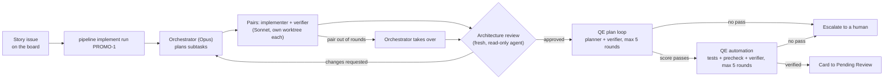

# First end-to-end runs of the AI pipeline: PROMO-1

**Five runs, each fixing what stopped the one before. Run 5 is the first to finish end to end (outcome `done`): a reviewed implementation, a verified test plan and verified automated tests, from one command, in 73 minutes. It was narrow. Test automation passed 9/10 in the last of its 5 rounds, after two formatting prechecks and a repeated verifier gap used up three rounds.**

This is the first trial of the [AI development pipeline](README.md) on a real story, [PROMO-1](https://github.com/armandodollia-slalom/AI-Immersion-eShop/issues/52) (the Promotions.API service scaffold for the eShop promotions and marketing features). Runs 1 to 4 happened on 2026-11-10 and Run 5 on 2026-11-11. Numbers come from each run's own metrics and logs.

## The flow

One command starts it: `node scripts/pipeline/pipeline.mjs implement run PROMO-1`. The pipeline reads the story from its issue on the eShop Story Board, creates a worktree and branch from `origin/main`, and moves the board card as the work progresses.

## Results

| Stage | Run 1 | Run 2 | Run 3 | Run 4 | Run 5 |
| --- | --- | --- | --- | --- | --- |
| Implement | About 255 s, 3 commits | Same commits, rebased | 224 s, 1 commit | 1 commit | 2 subtasks, 13 agent runs, 5 pair rounds, 1 takeover, 9 commits |
| Architecture review | Approved in round 1, minor notes | Approved in round 1 | Approved in round 1 | Approved in round 1 | Approved, 0 blocks |
| QE test plan | **Not converged**: 10 rounds, scores 7 to 9. 63 denials. | 10/10 in round 2 | 10/10 in round 1 | 8, 8, 9, 9, 9 then escalated. A rerun reached 10/10 in round 2. | **9/10 in round 1.** 26 cases, 4 gaps accepted. |
| QE automation | `blocked-on-plan` (a race). No tests. | `dotnet` not on the hooks' PATH | Precheck ran an xUnit-only filter on MSTest | Suite built. Network outage ended rounds 2 to 5. | **9/10 in round 5 of 5** |
| Outcome | Escalated | Stopped to fix | Escalated | Escalated | **Done** |

Run 1's plan denials by category: invented requirement 25, vague steps 13, duplicate case 7, untestable expectation 6, AC not covered 6, missing sad path 5, other 1.

### Run 5 in detail

- **Implement.** The Opus orchestrator planned for 45 s and delegated two subtasks to Sonnet implementer and verifier pairs: `service` (medium) and `wiring` (small). `service` passed in round 1. `wiring` ran out of its 4 pair rounds, with the pair going back and forth over making `testing/teststack.json` plain JSON and where its comments go. The orchestrator took it over and finished it.
- **Architecture review.** The Architecture Policy Pack was skipped because Python's `yaml` module was missing. That is fixed by installing `architecture-policy/requirements.txt`.
- **QE automation, round by round.**
  1. Precheck failed on `dotnet format` CHARSET: `.editorconfig` requires `utf-8-bom` and the agent's file writes don't add it. A functional-test run also hung for about 10 minutes.
  2. Verifier 8/10: TC-PROMO-1-21 tests a different path (it reads granted scopes from the Identity container log, not the WebApp's token), and TC-PROMO-1-02 depends on Aspire's health-check key naming.
  3. Precheck failed on ESLint `no-regex-spaces` in the Playwright spec.
  4. Verifier 8/10: the same TC-PROMO-1-21 gap.
  5. Verifier 9/10, passed. Two gaps remain: weak negative assertions in the 401 tests (TC-22, TC-23).
- **Suite.** Promotions functional tests (xUnit), AppHost unit tests (MSTest) and a Playwright spec, each run on the agent's own test stack slot (slot 1), not the shared stack.
- **Not done.** The PR check did not run in this headless story run (`pr-check: no result`). Publishing the Implementation Notes back to the issue was refused because #52 had changed on GitHub since it was fetched. Card #52 did move In Progress, Testing, Pending Review, and review notes were posted to it.
- **Run record.** `implementer_runs` 2, `review_blocks` 0, `bug_fix_cycles` 0, 5.6M tokens, $4.24 recorded cost.

## What we learned

1. **Story quality was the first bottleneck.** The story left "active", status codes, response shape and the empty case undefined. The verifier's denials pointed at exactly those gaps: *the AI test planner tells you what your story didn't say.* Its own rules also contradicted each other (demand every sad path, penalise anything unstated), so the same behavior was flagged as invented in one round and missing in the next.
2. **Runs 1 to 4 each moved the failure one stage later, and none was an agent quality problem.** A plan race, a missing `dotnet` on the PATH, an xUnit-only filter on MSTest projects, then a precheck false positive and a network outage that the loop counted as rounds.
3. **A 10/10 bar spends rounds on the last gap.** Run 4's plan reached 9 three times and escalated. PR #27 accepts 9/10, and Run 5's plan passed in round 1 under it, with 4 gaps accepted.
4. **Formatting prechecks cost whole rounds.** Rounds 1 and 3 of Run 5's automation failed only on mechanical rules (BOM, an ESLint rule) that a formatter fixes.
5. **The feedback loop forgets.** Each round sees only the previous round's feedback. Round 3's lint error replaced round 2's verifier gaps, so round 4 repeated the TC-21 gap.
6. **Some gaps are plan problems.** TC-21 asks a test to observe something it can't (the WebApp's token path), so no amount of test rewriting clears it.
7. **Pairs can stall on small points.** The `wiring` pair spent 4 rounds on JSON comments. The takeover worked as designed, but the rounds were wasted.

## What we changed

| Problem | Fix | Commit |
| --- | --- | --- |
| Under-specified story; conflicting verifier rules | Rewrote PROMO-1's Outputs, acceptance criteria and **Test scope**; "the story is the contract" rules in the plan agents | `3693bdf` |
| Automation gave up on a running plan | Automation waits for a plan loop already in progress | `3db664a` |
| `dotnet` not found by hooks and background runs | The pipeline adds `DOTNET_ROOT` or `~/.dotnet` to PATH when it is missing | `377040b` |
| xUnit-only story-test filter | Filter and tag are framework-aware (MSTest and xUnit) | `5b58cd9` |
| 10/10 bar spends rounds on one gap | Accept 9/10 from the plan and automation verifiers | PR #27 |
| Story-tag precheck false positive | Story tag required only where tests are | PR #73 (`fix/qe-precheck-story-tag`) |
| Policy Pack skipped | Install `architecture-policy/requirements.txt` | Setup step |
| Same problem for the next story | `/create-story` requires precise Outputs and a Test scope | Skill file, not in this repo |

The implement stage itself is commit `9293e05`; see [implement.md](implement.md).

## What's next

- **Auto-fix formatting before the precheck.** Run `dotnet format` and `eslint --fix` on the agent's files. This would have saved rounds 1 and 3.
- **Let qe-automation run its own precheck.** A `qe precheck <KEY>` command it calls before finishing.
- **Keep unresolved verifier gaps in the feedback** until a verifier round clears them. This would likely have saved round 4.
- **Route unobservable cases back to the plan.** Verifiers flag them with `root_stage: plan`, so the plan loop rewrites them.
- **Retry or pause on infrastructure errors** instead of counting them as rounds.
- **Close the loose ends of Run 5.** The PR check did not run headless, and the Implementation Notes were not published to the issue.
- **Earlier open items.** Duplicate plan runs from the post-commit hook, plan layers (AppHost wiring cases want `unit`, plans accept `functional` and `e2e`), and solution-file edits changing the approved fingerprint.
- **More stories.** Run PROMO-2 to PROMO-4 in parallel.

## See also

- [First epic run: Promotions & Recommendations (in progress)](demo-epic-promo-2-results.md): the same pipeline on a whole epic, starting with PROMO-2.
