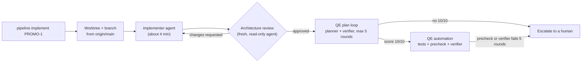

# First end-to-end runs of the AI pipeline: PROMO-1

**Each run got further than the last. Run 3, from a clean `main`, took one command to a reviewed implementation, a 10/10 test plan and a full set of written tests. Those tests are blocked by a test-runner mismatch in the QE config, not by the story or the agents.**

This is the first trial of the [AI development pipeline](README.md) on a real story, [PROMO-1](https://github.com/armandodollia-slalom/AI-Immersion-eShop/issues/52) (the Promotions.API service scaffold for the eShop promotions and marketing features). All three runs happened on 2026-11-10. Numbers come from each run's own metrics and logs.

## The flow

One command starts it: `node scripts/pipeline/pipeline.mjs implement PROMO-1`. It creates a worktree and branch from `origin/main` and runs the `implementer` agent headless with hooks on. Everything after that is driven by hooks.

## Results

| Stage | Run 1 | Run 2 (after the story and verifier fixes) | Run 3 (after the fixes, from `main`) |
| --- | --- | --- | --- |
| Implement | 1 run, about 255 s, 3 commits. Build and existing unit tests passed (agent's report). Stack not run end to end. | Same three commits, rebased onto the fixed story | 1 run, 224 s, 1 commit. Build and AppHost unit tests passed (agent's report). |
| Architecture review | **Approved in round 1**, minor notes only (Swagger UI client not defined in Identity, seed not atomic, entities returned directly) | Approved in round 1 | Approved in round 1 |
| QE test plan | **Did not converge.** 10 verifier rounds, scores 7, 8, 9, 8, 9, then 9, 8, 8, 8, 7. 21 cases, 63 denials. Escalated. | **Verified 10/10 in round 2.** 24 cases, 12 denials. | **Verified 10/10 in round 1.** A duplicate plan run from the post-commit hook ran in parallel (5 rounds, scores 7, 8, 8) and escalated. Two prechecks failed and self-corrected: a layer label, and an index entry with no case file. |
| QE automation | Gave up with `blocked-on-plan` (a race). No tests written. | Tests written. Rounds 2 and 3 failed because `dotnet` wasn't on the hooks' PATH. Stopped to fix it. | `dotnet` found, builds ran. Wrote the full suite (below). **All 5 rounds failed the precheck on one command; the verifier never ran.** Escalated. |

Run 3's suite: new `tests/Promotions.FunctionalTests` and `tests/Identity.FunctionalTests` projects, `PromotionsAppHostTests.cs`, a Playwright spec (`e2e/teststack/promo-1-promotions-scope.spec.ts`) and a test-stack scenario (`testing/scenarios/promo-1/`).

Run 1 plan denials by category: invented requirement 25, vague steps 13, duplicate case 7, untestable expectation 6, AC not covered 6, missing sad path 5, other 1.

## What we learned

1. **Story quality was the first bottleneck.** The story left "active", status codes, response shape, the empty case and the stub endpoint undefined, and asked for a startup-order check that can only be tested by timing. The verifier's denials pointed at exactly those gaps: *the AI test planner tells you what your story didn't say.*
2. **The verifier's rules contradicted each other.** One demanded every sad path, another penalised anything unstated, so the same behavior was flagged as invented in one round and missing in the next.
3. **The plan race is fixed, and a cost problem remains.** In Run 1 automation gave up when it found a plan lock. In Run 3 it waited, then planned again and passed. But the implementer's commit touches the story, so the post-commit hook still starts its own plan run in parallel. That run burned about 5 rounds and left a spurious escalation file.
4. **The next blocker was a wrong assumption in the QE config.** `precheck.dotnet` in `scripts/qe/config.json` filters with xUnit's `--filter-trait`. This repo's test projects use MSTest (`MSTest.Sdk`), which has no such option: the command prints help and exits non-zero. The automation agent had been told to tag tests with `[Trait]`, so it even added a `TraitAttribute.cs` shim to satisfy the gate. PR #7 had listed `--filter-trait` as unverified; the run is what verified it.
5. **Each run moved the failure one stage later.** Run 1 stopped at the plan, Run 2 at the PATH, Run 3 at the test-runner filter. None of the three was an agent quality problem.

## What we changed

| Problem | Fix | Commit |
| --- | --- | --- |
| Under-specified story | Rewrote PROMO-1's Outputs and acceptance criteria, added a **Test scope** section, closed the open questions | `3693bdf` |
| Conflicting verifier rules | "The story is the contract" rules in the `qe-plan-verifier` and `qe-plan` agents | `3693bdf` |
| Automation gave up on a running plan | Automation waits for a plan loop already in progress (confirmed in Run 3) | `3db664a` |
| `dotnet` not found by hooks and background runs | The pipeline adds `DOTNET_ROOT` or `~/.dotnet` to PATH when `dotnet` is missing (confirmed in Run 3) | `377040b` |
| Same problem for the next story | The `/create-story` skill now requires precise Outputs and a Test scope section | Skill file, not in this repo |

The implement stage itself is commit `9293e05`; see [implement.md](implement.md).

## What's next

- **Make the story-test filter framework-aware.** MSTest uses `[TestCategory("PROMO-1")]` and `--filter "TestCategory=PROMO-1"`; xUnit uses `[Trait]` and `--filter-trait`. Then re-run automation only: `node scripts/qe/qe.mjs automate PROMO-1`.
- **Stop duplicate plan runs.** The post-commit hook should not start a plan run for a story the implement stage is already driving.
- **Plan layers.** The verifier wants AppHost wiring cases labelled as unit tests, as the story's Test scope says, but plans accept only `functional` and `e2e`. Run 3's precheck rejected the label again. Decide whether plans should allow `unit`.
- **Solution files count as implementation.** Adding a test project edits `eShop.slnx`, `eShop.Web.slnf` and `Directory.Packages.props`, which changes the approved implementation's fingerprint. Exclude them from the review hash, or have the implementer make those edits.
- **Run the stack end to end.** The implementer only builds and runs existing unit tests.
- **More stories.** Run PROMO-2 to PROMO-4 in parallel with `--background`, once the above is fixed.

## See also

- [First epic run: Promotions & Recommendations (in progress)](demo-epic-promo-2-results.md): the same pipeline on a whole epic, starting with PROMO-2.
