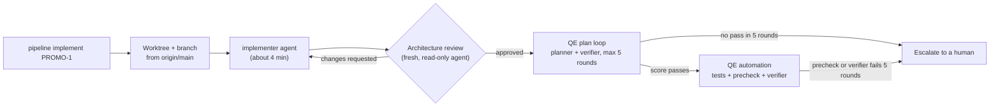

# First end-to-end runs of the AI pipeline: PROMO-1

**Four runs, each fixing what stopped the one before. In Run 4 the implementation was approved, the test plan passed, and the agent wrote and built a full suite of 42 functional tests plus AppHost and Playwright tests. The loop then lost its last rounds to a false-positive precheck and a network outage. The automation verifier has still never scored the tests.**

This is the first trial of the [AI development pipeline](README.md) on a real story, [PROMO-1](https://github.com/armandodollia-slalom/AI-Immersion-eShop/issues/52) (the Promotions.API service scaffold for the eShop promotions and marketing features). All four runs happened on 2026-11-10. Numbers come from each run's own metrics and logs.

## The flow

One command starts it: `node scripts/pipeline/pipeline.mjs implement PROMO-1`. It creates a worktree and branch from `origin/main` and runs the `implementer` agent headless with hooks on. Everything after that is driven by hooks.

## Results

| Stage | Run 1 | Run 2 (story and verifier fixes) | Run 3 (from `main`) | Run 4 (filter fix, Sonnet) |
| --- | --- | --- | --- | --- |
| Implement | About 255 s, 3 commits | Same commits, rebased | 224 s, 1 commit | 1 commit (`0b89bcc`) |
| Architecture review | **Approved in round 1**, minor notes only (Swagger UI client not defined in Identity, seed not atomic, entities returned directly) | Approved in round 1 | Approved in round 1 | Approved in round 1 |
| QE test plan | **Did not converge.** 10 verifier rounds, scores 7 to 9. 21 cases, 63 denials. Escalated. | **10/10 in round 2.** 24 cases. | **10/10 in round 1.** A duplicate plan run from the post-commit hook ran in parallel and escalated. | First loop scored 8, 8, 9, 9, 9 against a 10/10 bar and escalated (3 gaps, all in TC-PROMO-1-23). A rerun verified **10/10 in round 2**. 24 cases. |
| QE automation | Gave up with `blocked-on-plan` (a race). No tests written. | Tests written. Rounds 2 and 3 failed: `dotnet` not on the hooks' PATH. | Full suite written. All 5 rounds failed the precheck on an xUnit-only filter. | Round 1 (about 50 min) wrote the full suite, which builds with 0 errors. Precheck failed once, falsely. Rounds 2 to 5 never ran (network outage). Escalated. |

Run 4 ran automation under the 9/10 rule (see below), 21:40 to 23:02 UTC. Its suite: `tests/Promotions.FunctionalTests` (xUnit, 42 tests in 4 files), `PromotionsAppHostTests.cs` (MSTest), the Playwright spec `e2e/teststack/promo-1-promotions.spec.ts` and the scenario `testing/scenarios/promo-1/`. Commit `39b063c` added the plan and tests.

Run 1 plan denials by category: invented requirement 25, vague steps 13, duplicate case 7, untestable expectation 6, AC not covered 6, missing sad path 5, other 1.

## What we learned

1. **Story quality was the first bottleneck.** The story left "active", status codes, response shape and the empty case undefined, and asked for a timing-based startup-order check. The verifier's denials pointed at exactly those gaps: *the AI test planner tells you what your story didn't say.*
2. **The verifier's rules contradicted each other.** One demanded every sad path, another penalised anything unstated, so the same behavior was flagged as invented in one round and missing in the next.
3. **Each fix moved the failure one stage later, and none was an agent quality problem.** Run 1 stopped at the plan, Run 2 at the PATH, Run 3 at the test-runner filter. The filter was xUnit's `--filter-trait`, but the repo's test projects use MSTest (PR #7 had listed it as unverified). The fix (`5b58cd9`) worked: Run 4 had no filter failures.
4. **A 10/10 bar spends rounds on the last gap.** Run 4's first plan loop reached 9 three times with all remaining gaps in one case, then escalated. A rerun passed. That led to PR #27: accept a score at or above `requiredScore`, with gaps allowed at 9.
5. **The precheck has false positives.** It treats any file that mentions a case id as a test file. `PromotionsHost.cs` (a `WebApplicationFactory` helper with no tests) mentions TC-PROMO-1-23 in a comment, so the precheck asked for a `[Trait("Story", "PROMO-1")]` tag on it.
6. **The loop spends rounds on infrastructure errors.** Rounds 2 to 5 failed with `API Error: Can't reach the API server (ENOTFOUND)`, a DNS outage on the machine. The loop counted them as failed rounds and escalated, so the verifier never ran.
7. **Duplicate plan runs remain a cost.** The implementer's commit touches the story, so the post-commit hook still starts its own plan run in parallel (Run 3: about 5 wasted rounds and a spurious escalation).

## What we changed

| Problem | Fix | Commit |
| --- | --- | --- |
| Under-specified story | Rewrote PROMO-1's Outputs and acceptance criteria, added a **Test scope** section | `3693bdf` |
| Conflicting verifier rules | "The story is the contract" rules in the `qe-plan-verifier` and `qe-plan` agents | `3693bdf` |
| Automation gave up on a running plan | Automation waits for a plan loop already in progress | `3db664a` |
| `dotnet` not found by hooks and background runs | The pipeline adds `DOTNET_ROOT` or `~/.dotnet` to PATH when `dotnet` is missing | `377040b` |
| xUnit-only story-test filter | Filter and tag are framework-aware (MSTest and xUnit) | `5b58cd9` |
| 10/10 bar spends rounds on one gap | Accept 9/10 from the plan and automation verifiers | PR #27 |
| Same problem for the next story | The `/create-story` skill requires precise Outputs and a Test scope section | Skill file, not in this repo |

The implement stage itself is commit `9293e05`; see [implement.md](implement.md).

## What's next

- **Fix the precheck.** Require the story tag only in files that contain tests (`[Fact]`, `[Theory]`, `[TestMethod]`), not files that mention a case id.
- **Retry or pause on infrastructure errors.** Network and API failures should not count as rounds.
- **Re-run automation only:** `node scripts/qe/qe.mjs automate PROMO-1`, once the precheck fix is in. This is the run that should finally get a verifier score.
- **Stop duplicate plan runs.** The post-commit hook should not start a plan run for a story the implement stage is driving.
- **Plan layers.** The verifier wants AppHost wiring cases labelled as unit tests, but plans accept only `functional` and `e2e`. Decide whether plans should allow `unit`.
- **Solution files count as implementation.** Adding a test project edits `eShop.slnx`, `eShop.Web.slnf` and `Directory.Packages.props`, which changes the approved implementation's fingerprint. Exclude them from the review hash, or have the implementer make those edits.
- **Run the stack end to end, then more stories.** The implementer only builds and runs existing unit tests. After that, run PROMO-2 to PROMO-4 in parallel.
