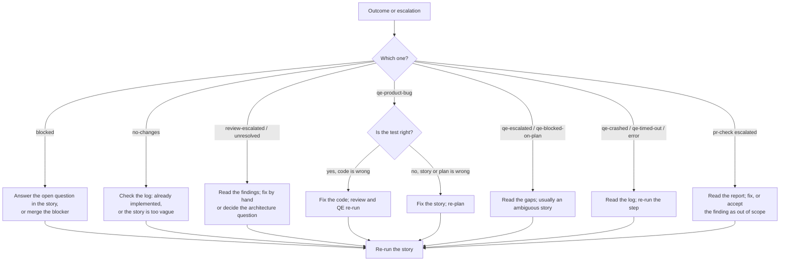
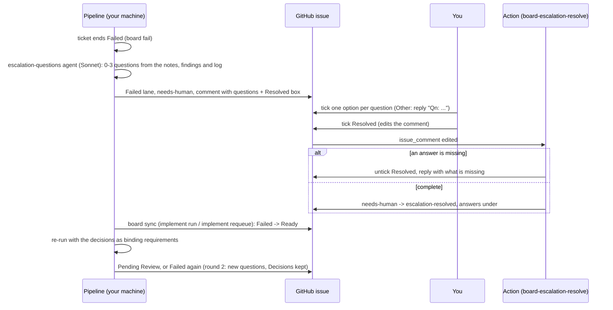

# Handling escalations and failed stories

Part of the [AI development pipeline](README.md). Every agent loop has a limit. When a loop can't converge, the pipeline stops, writes an escalation for a human and lets the agent finish its turn. This page is what you do next.

## Where to look

| What | Where |
| --- | --- |
| Batch progress and outcome per story | `node scripts/pipeline/pipeline.mjs implement status [KEY]` (main checkout) |
| Per-story stage state (review rounds, QE status, PR check score) | `node scripts/pipeline/pipeline.mjs status KEY`, run inside the story's worktree |
| Escalation notes | `.agent-state/escalations/<KEY>-<stage>.md` (in the worktree for `implement run`); also in the collapsed details of the failure comment on the issue |
| Questions for you and the Resolve checkbox | the latest failure comment on the issue ([below](#questions-and-the-resolve-checkbox)) |
| Runner logs | `.agent-state/logs/implement-<KEY>-*.log` (main checkout) |
| Stage logs (QE, PR check background runs) | `.agent-state/logs/<KEY>-<stage>-*.log` (worktree) |
| PR check report | `.agent-state/pr-check/<id>/report.md` |

Escalations are written for the `review`, `plan`, `automation` and `pr-check` stages. The next agent session in that checkout is told about them at start-up. Each one is deleted automatically when its stage later passes (review approval, a verified plan or test suite, a passing PR check); you can also delete the file once you have dealt with it.

## Decision guide



| Outcome | What happened | What to do |
| --- | --- | --- |
| `blocked` | The implementer stopped on a design-changing Open Question or an unimplemented blocker, or the blockers' branches conflict | Answer the question in the story (commit it), merge the blocker, or resolve the conflict in the worktree. Re-run the story |
| `no-changes` | The implementer changed no implementation files | Check the runner log. If the feature already exists, add `## Implementation Notes` to the story by hand; if the story is too vague, sharpen it |
| `review-escalated` | No approval within `review.maxRounds` (5) | Read `<KEY>-review.md`. Either fix the code yourself in the worktree, or settle the disagreement (a story change, or a policy pack exception under `architecture-policy/exceptions/`). Then re-run |
| `unresolved` | Still not approved after `maxImplementerRuns` (8) implementer runs | Same as `review-escalated` |
| `qe-product-bug` | The tests contradict the code after `maxBugFixCycles` (2) fix cycles | Read `<KEY>-automation.md`. If the test matches the story, the code is wrong: fix it and finish again. If the story was ambiguous, fix the story and re-plan |
| `qe-escalated` | The plan or tests didn't reach 10/10 in 5 rounds | Read `<KEY>-plan.md` or `<KEY>-automation.md`. Gaps that repeat usually point to an ambiguous story |
| `qe-blocked-on-plan` | The plan could not be verified, so no tests were written | Same as a `plan` escalation |
| `qe-crashed`, `qe-timed-out`, `error` | A process died or ran past its timeout (`qeTimeoutSec`, `implementerTimeoutSec`) | Read the log, fix the cause (agent CLI not signed in, Docker not running, a hung test), then re-run |
| PR check escalated | `hook.maxRuns` (3) failing checks, or the loop stalled | Read the report. Fix the upheld findings, or record why a finding is out of scope in the PR description |
| `skipped` | Already implemented, or a blocker didn't finish | Fix the blocker; dependents run when you re-run the batch |

## Questions and the Resolve checkbox

Agents never ask questions while a ticket runs: they make a documented choice, or stop. Questions are asked once, when the card moves to **Failed**, and answered on the issue.



1. **Questions step.** `board fail` reads the escalation notes the run left (`.agent-state/escalations/<KEY>-*.md`, in the ticket worktree), its findings and the end of its log, and asks the `escalation-questions` agent (Sonnet, `agent.models.escalationQuestions` in `scripts/board/config.json`, checked by `npm run models:check`) for at most three questions only a human can answer, each with two or three options, one recommended. Mechanical failures (`error`, `qe-crashed`, `qe-timed-out`, `qe-not-started`, an agent provider outage, a skipped dependent) get no questions. If the call fails, the comment goes out without questions; `board fail` never fails because of this step. A replayed `board fail` (same event id) posts nothing and asks nothing.
2. **The failure comment.** A one-line summary, the questions as task lists (one `- [ ] **A.** ...` line per option, then `- [ ] **Other**`, answered by a `Q1: ...` reply), the escalation notes, findings, branch and log collapsed under **Details**, then `- [ ] **Resolved**: I've answered the questions; re-queue this ticket`. A hidden marker (`<!-- pipeline-escalation:{"key","round","questions":[{"id","options"}]} -->`) lets automation read it.
   A ticket that did not run because a blocker failed (outcome `skipped`, "blocker X ended ...") gets no questions: its comment names the blocker, which holds the decision. Resolve the blocker first. The runner records such a ticket's outcome when the batch ends, so a later run that skips it for the same reason replays the failure instead of posting a new comment.
3. **You answer.** Tick exactly one box per question. For **Other**, reply in a new comment whose line starts with `Q2: ...` (one comment may answer several, one `Qn:` per line). Then tick **Resolved**.
4. **The Action checks** (`.github/workflows/board-escalation-resolve.yml`, `board resolve-check`, `github.token` with `issues: write` only). It acts only on the latest failure comment. A question with no box or several boxes ticked, or **Other** without a later `Qn:` reply by a human (bot comments and pipeline comments never count), unticks **Resolved** and replies with the list. Otherwise it removes `needs-human`, adds `escalation-resolved`, writes the answers to the issue body under `## Decisions` (round, question, answer, who, when; a round is replaced, never duplicated) and replies `Resolved by @you. Decisions recorded: ...`. Adding the `escalation-resolved` label by hand does the same (it records whatever is ticked, and notes what is unanswered).
5. **Re-queue.** `board sync` moves Failed cards labeled `escalation-resolved` without `needs-human` to Ready. It runs at the start of every `implement run`, by hand, or from [`implement requeue`](#requeue-on-a-timer). Actions never need a project token.
6. **Re-run with the answers.** `implement run`/`resume` treat `escalation-resolved` as permission to run the ticket again, fresh (like `--force` for that ticket's earlier run, including a standing QE or review escalation). `board fetch` writes the `## Decisions` next to the cached story (`decisions.md`), and the implementer, the orchestrator's plan and integration, the pair implementers and verifiers, the architecture reviewer and the QE planner, automation engineer and their verifiers get them as **Human decisions (binding requirements)**: reviewers and QE flag code that contradicts a decision instead of reopening it. When the re-run claims the card, it removes `escalation-resolved` and deletes the ticket's old escalation notes.
7. **Round 2.** If the ticket fails again, a new comment asks again (round 2), and the earlier rounds stay under `## Decisions` as context. `board publish` keeps the section when it rewrites the issue body.

## Requeue on a timer

`node scripts/pipeline/pipeline.mjs implement requeue` picks up every ticket you resolved and runs them in one batch, so you can answer several Failed tickets on GitHub and have them run together:

1. Skips (exit 0, logged) when an `implement run` is active on this machine, the last one was interrupted (resume it first: `implement resume`), another requeue is running, or the agent provider reported an outage in the last `implement.requeue.outageCooldownMin` (60) minutes (`.agent-state/implement/agent-outage.json`).
2. Runs `board sync`, which moves the resolved Failed cards to Ready. Nothing resolved: exits 0.
3. Starts `implement run <KEY...> --parallel auto --pr` for all of them. Bug fixes a person reopened after the [review gate](review-gate.md#human-reopens) assessed them (`reopened` in `board sync --json`) run too, in their own runs with `--force`: on their PR's branch while the PR is open, else as a follow-up PR. Tickets of an epic whose epic run is still in progress go per delivery unit (one run per bug-epic PR group they belong to), so they join their group's branch and PR; every other ticket goes in the single run. A run that stops on a provider outage (exit 75) stops the requeue too.

`--requeue-only` moves the cards and starts nothing; `--dry-run` lists what it would run without moving anything; `--parallel N`, `--no-pr` and `--base <ref>` pass through. Each pass logs to `.agent-state/logs/requeue-<time>.log` (the runs' output included) and records itself in `.agent-state/implement/requeue-last.json`.

**macOS (launchd).** From your main checkout, with the shell environment the pipeline should use (agent CLI on `PATH`, `PIPELINE_AGENT_CLI`, signed in to `gh` and the agent CLI):

```bash
node scripts/implement/requeue-schedule.mjs install --interval 60   # writes ~/Library/LaunchAgents/com.eshop.pipeline.requeue.plist and loads it
node scripts/implement/requeue-schedule.mjs install --dry-run       # print the plist only
node scripts/implement/requeue-schedule.mjs status                  # installed?, interval, last requeue and its log
node scripts/implement/requeue-schedule.mjs uninstall
```

The agent runs `pipeline implement requeue` from the main checkout every interval (minimum 5 minutes) with the `PATH`, `HOME`, `PIPELINE_*`, `DOTNET_ROOT`, `CLAUDE_CONFIG_DIR` and `GH_CONFIG_DIR` of the shell that installed it; no secret is written to the plist. launchd output goes to `.agent-state/logs/requeue-launchd.log`.

**Windows (Task Scheduler).** In PowerShell from the main checkout:

```powershell
$node = (Get-Command node).Source
$action = New-ScheduledTaskAction -Execute $node -Argument 'scripts/pipeline/pipeline.mjs implement requeue' -WorkingDirectory (Get-Location)
$trigger = New-ScheduledTaskTrigger -Once -At (Get-Date) -RepetitionInterval (New-TimeSpan -Minutes 60)
Register-ScheduledTask -TaskName 'eShop pipeline requeue' -Action $action -Trigger $trigger -Settings (New-ScheduledTaskSettingsSet -MultipleInstances IgnoreNew)
# status: Get-ScheduledTaskInfo 'eShop pipeline requeue'; remove: Unregister-ScheduledTask 'eShop pipeline requeue'
```

The task runs as you, so it uses your `PATH` and sign-ins; set `PIPELINE_AGENT_CLI` as a user environment variable if you need it.

## Re-running

- **After answering the questions:** tick **Resolved** on the issue; the next `implement run` or `implement requeue` runs it with your answers ([above](#questions-and-the-resolve-checkbox)).
- **A whole story:** `node scripts/pipeline/pipeline.mjs implement run <KEY>`. It reuses the existing worktree and branch, calls `pipeline start` (which resets the review rounds and PR check runs) and continues from the code already on the branch. Add `--force` if the story file you pass already has `## Implementation Notes`.
- **Only the tests:** from the worktree, `node scripts/qe/qe.mjs plan KEY` and `node scripts/qe/qe.mjs automate KEY` (add `--background` to detach).
- **Only the review:** `node scripts/review/review.mjs run KEY` runs one round and prints it.
- **Interactively:** open an agent session in the worktree, run `node scripts/pipeline/pipeline.mjs start KEY`, make the fix, then `node scripts/pipeline/pipeline.mjs done`. The Stop hook runs review, QE and the PR check again.

Any code change after an approval makes the review run again first, and QE and the PR check follow the newly approved hash.

These commands are the same in Terminal on macOS and in PowerShell on Windows. To skip a gate for one push, run `QE_SKIP=1 git push` on macOS, or `$env:QE_SKIP = '1'; git push; Remove-Item Env:QE_SKIP` in PowerShell.

## Cleaning up

`implement run` never deletes worktrees. Once a story's branch is merged or abandoned, run these from the main checkout (same commands on macOS and Windows; git accepts forward slashes in PowerShell too):

```bash
git worktree list
git worktree remove ../<repo>-worktrees/<key>
git branch -D feat/<key>-<title>
```

If `git worktree remove` fails on Windows because a file is in use, close any editor, terminal or `dotnet` process still running in that folder, then try again.

`.agent-state/` is not committed; deleting a story's `stories/<KEY>.json` there resets all of its stage state. Keep `.agent-metrics/`: it is committed and feeds the lessons.
