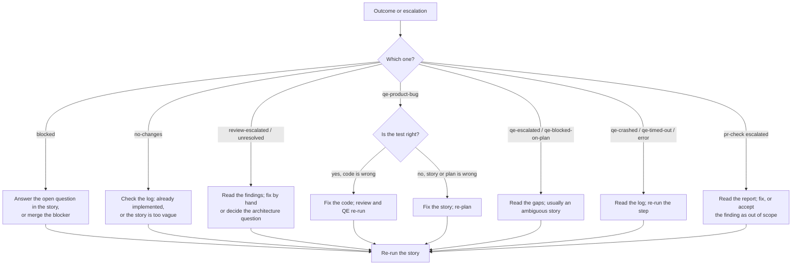

# Handling escalations and failed stories

Part of the [AI development pipeline](README.md). Every agent loop has a limit. When a loop can't converge, the pipeline stops, writes an escalation for a human and lets the agent finish its turn. This page is what you do next.

## Where to look

| What | Where |
| --- | --- |
| Batch progress and outcome per story | `node scripts/pipeline/pipeline.mjs implement status [KEY]` (main checkout) |
| Per-story stage state (review rounds, QE status, PR check score) | `node scripts/pipeline/pipeline.mjs status KEY`, run inside the story's worktree |
| Escalation notes | `.agent-state/escalations/<KEY>-<stage>.md` (in the worktree for `implement run`) |
| Runner logs | `.agent-state/logs/implement-<KEY>-*.log` (main checkout) |
| Stage logs (QE, PR check background runs) | `.agent-state/logs/<KEY>-<stage>-*.log` (worktree) |
| PR check report | `.agent-state/pr-check/<id>/report.md` |

Escalations are written for the `review`, `plan`, `automation` and `pr-check` stages. The next agent session in that checkout is told about them at start-up. Each one is deleted automatically when its stage later passes (review approval, a verified plan or test suite, a passing PR check); you can also delete the file once you have dealt with it.

## Decision guide



| Outcome | What happened | What to do |
| --- | --- | --- |
| `blocked` | The implementer stopped on a design-changing Open Question or an unimplemented blocker, or the blockers' branches conflict | Answer the question in the story (commit it), merge the blocker, or resolve the conflict in the worktree. Re-run the story |
| `no-changes` | The implementer changed no implementation files | Check the runner log. If the feature already exists, add `## Implementation Notes` to the story by hand; if the story is too vague, sharpen it |
| `review-escalated` | No approval within `review.maxRounds` (5) | Read `<KEY>-review.md`. Either fix the code yourself in the worktree, or settle the disagreement (a story change, or a policy pack exception under `architecture-policy/exceptions/`). Then re-run |
| `unresolved` | Still not approved after `maxImplementerRuns` (8) implementer runs | Same as `review-escalated` |
| `qe-product-bug` | The tests contradict the code after `maxBugFixCycles` (2) fix cycles | Read `<KEY>-automation.md`. If the test matches the story, the code is wrong: fix it and finish again. If the story was ambiguous, fix the story and re-plan |
| `qe-escalated` | The plan or tests didn't reach 10/10 in 5 rounds | Read `<KEY>-plan.md` or `<KEY>-automation.md`. Gaps that repeat usually point to an ambiguous story |
| `qe-blocked-on-plan` | The plan could not be verified, so no tests were written | Same as a `plan` escalation |
| `qe-crashed`, `qe-timed-out`, `error` | A process died or ran past its timeout (`qeTimeoutSec`, `implementerTimeoutSec`) | Read the log, fix the cause (agent CLI not signed in, Docker not running, a hung test), then re-run |
| PR check escalated | `hook.maxRuns` (3) failing checks, or the loop stalled | Read the report. Fix the upheld findings, or record why a finding is out of scope in the PR description |
| `skipped` | Already implemented, or a blocker didn't finish | Fix the blocker; dependents run when you re-run the batch |

## Re-running

- **A whole story:** `node scripts/pipeline/pipeline.mjs implement run product-research/stories/<KEY>-<title>.md`. It reuses the existing worktree and branch, calls `pipeline start` (which resets the review rounds and PR check runs) and continues from the code already on the branch. Add `--force` if the story file you pass already has `## Implementation Notes`.
- **Only the tests:** from the worktree, `node scripts/qe/qe.mjs plan KEY` and `node scripts/qe/qe.mjs automate KEY` (add `--background` to detach).
- **Only the review:** `node scripts/review/review.mjs run KEY` runs one round and prints it.
- **Interactively:** open an agent session in the worktree, run `node scripts/pipeline/pipeline.mjs start KEY`, make the fix, then `node scripts/pipeline/pipeline.mjs done`. The Stop hook runs review, QE and the PR check again.

Any code change after an approval makes the review run again first, and QE and the PR check follow the newly approved hash.

These commands are the same in Terminal on macOS and in PowerShell on Windows. To skip a gate for one push, run `QE_SKIP=1 git push` on macOS, or `$env:QE_SKIP = '1'; git push; Remove-Item Env:QE_SKIP` in PowerShell.

## Cleaning up

`implement run` never deletes worktrees. Once a story's branch is merged or abandoned, run these from the main checkout (same commands on macOS and Windows; git accepts forward slashes in PowerShell too):

```bash
git worktree list
git worktree remove ../<repo>-worktrees/<key>
git branch -D feat/<key>-<title>
```

If `git worktree remove` fails on Windows because a file is in use, close any editor, terminal or `dotnet` process still running in that folder, then try again.

`.agent-state/` is not committed; deleting a story's `stories/<KEY>.json` there resets all of its stage state. Keep `.agent-metrics/`: it is committed and feeds the lessons.
