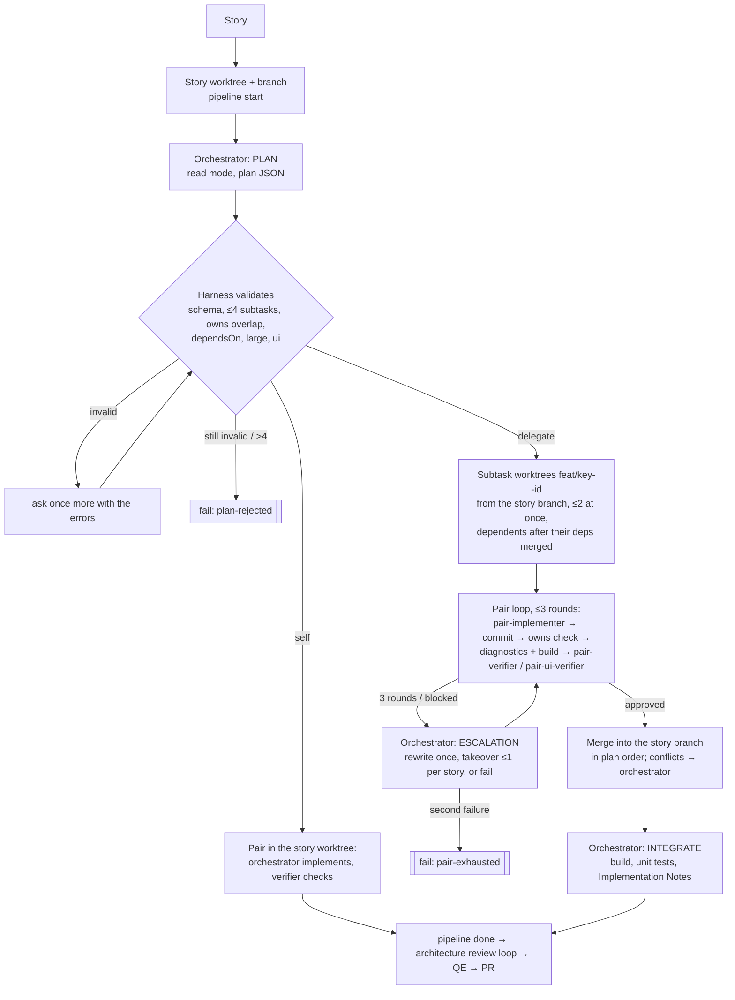

# Implement stage

Give the pipeline story keys (or an epic) from the [board](board.md) and it implements them: one worktree and feature branch per story, the [implementer agent](../../.github/agents/implementer.agent.md) as an **orchestrator** that plans the story into subtasks, **verifier pairs** that implement and check each subtask in its own worktree, then the [architecture review](review.md) loop and [verified tests](qe.md). A deterministic Node harness runs the loops; every agent is a separate headless CLI process, so it works the same with Claude Code, Copilot CLI, Codex or `PIPELINE_AGENT_CMD`.

```bash
node scripts/pipeline/pipeline.mjs implement run --epic promotions-and-recommendations --dry-run
node scripts/pipeline/pipeline.mjs implement run PROMO-3 PROMO-4                   # one story at a time
node scripts/pipeline/pipeline.mjs implement run PROMO-3 PROMO-4 --parallel 3 --pr
node scripts/pipeline/pipeline.mjs implement PROMO-3                              # a story key, fetched from its issue
node scripts/pipeline/pipeline.mjs implement run --epic promotions-and-recommendations --pr   # every story of the epic (its sub-issues)
node scripts/pipeline/pipeline.mjs implement status                            # live progress, from another terminal
node scripts/pipeline/pipeline.mjs implement cleanup [KEY]                     # remove subtask worktrees a failed run kept
node scripts/pipeline/pipeline.mjs implement resume                            # continue a run that was interrupted
node scripts/pipeline/pipeline.mjs implement metrics
node scripts/pipeline/pipeline.mjs implement decisions [--story KEY] [--json]  # how the orchestrator's choices turned out
```

| Option | Meaning |
| --- | --- |
| `--dry-run` | Print the order, branches and bases, then stop. No agents run. |
| `--parallel N` | Run up to N stories at once (default 1). Each has its own worktree; dependents still wait for their blockers. |
| `--base <ref>` | Base for stories with no in-batch blocker (default `baseRef`, `origin/main`; fetched first). |
| `--pr` | Push each finished branch and open a PR with `gh`, against its base branch (stacked PRs for dependents). |
| `--epic <EPIC>` | Implement every story and bug of the epic (its sub-issues on the board, fetched into the ticket cache), in Blocked-by order, in addition to any given. The epic's own ticket folder (its body and mockups) is handed to the agents too. |
| `--force` | Also implement stories that already have `## Implementation Notes`, and run stories whose [board](board.md) card is already in Pending Review or Done. |
| `--takeover` | Take over board cards another machine holds in In Progress or Testing (otherwise those stories, and stories stacked on them, are skipped). |

## What happens



1. **Plan.** Every key given is fetched from its issue into the ticket cache (`.agent-state/board/<KEY>/`; an unchanged issue is not downloaded again), and its cached `story.md` is the story. A cached `story.md` path, or a `<KEY>-<title>.md` file or folder of them, works too. A story that already has `## Implementation Notes` is skipped. Each story's `**Blocked by:**` line is parsed. Stories blocked by others in the batch run after them, and a dependency cycle is an error. Blockers outside the batch are left to the implementer, which checks that their code exists.
2. **Worktree.** Each story gets `../<repo>-worktrees/<key>` on `feat/<key>-<title>`. A story with no in-batch blocker branches from the base. A dependent stacks on the branch of the blocker that already contains the most of its other blockers and merges in the rest; a merge conflict marks the story `blocked`. Rerunning reuses existing worktrees and branches. The story's ticket folder (story, metadata, its own mockups) is copied into the worktree's ticket cache, and into each subtask worktree, so every stage there reads the same text; nothing about the story is committed. When the story finishes, the runner publishes the cached story (with the implementer's Implementation Notes) back to its issue (`board publish`). The runner calls `pipeline start`, and starts the language server daemon for the story worktree (if the LSP tooling is installed).
3. **Orchestrator plan.** The implementer agent runs in PLAN mode (read-only) and ends with `AGENT_RESULT: <plan JSON>` (a last fenced `json` block is accepted too). The harness validates it (see [Plan](#plan)); an invalid plan goes back once with the errors, then the story fails `plan-rejected`. More than `maxSubtasks` subtasks fails at once with "split the story". An orchestrator that reports the story blocked ends it `blocked`.
4. **Verifier pairs.** For each subtask the harness creates `../<repo>-worktrees/<key>--<id>` on `feat/<key>--<id>` from the story branch's current head (copying the story worktree's graphify graph, running `prepareCmd` (a `dotnet restore`) and starting a language server limited to the subtask's projects). Then, up to `maxPairRounds` times:
   - the **pair-implementer** (implement mode, the subtask's model class, no subagents) implements and commits;
   - the harness checks the diff against `owns`: any other changed file fails the round with a finding naming it (the verifier is not asked);
   - the harness runs language server diagnostics on the changed files and the `checks` (build) plus the unit tests of each touched service; a failing build fails the round;
   - a fresh **pair-verifier** (read mode, model class `medium`) gets only the subtask spec, the diff against the story branch and that output, and returns `APPROVED` or `CHANGES_REQUESTED` with findings tied to file and line. For `verify: "ui"` subtasks the **pair-ui-verifier** (verify mode, model class `large`) checks the running app instead (see [UI verification](#ui-verification)). Diagnostics errors in changed files block approval whatever the verdict;
   - blocking findings, screenshot paths and diagnostics go verbatim to the next implementer round. A verdict that breaks the output contract is asked for again once; if it is still unusable the round is spent and the next round only re-verifies.

   Subtasks whose dependencies are merged start as soon as a pair slot is free (`maxConcurrentPairs` per story). Every agent run also takes one of `maxConcurrentAgents` machine-wide slots (lock files under the git common dir, shared by all worktrees and story processes; a slot held by a dead process is reclaimed).
5. **Escalation.** A pair that uses all its rounds or reports blocked goes back to the orchestrator (implement mode, in the subtask worktree with the pair's last attempt, all findings in the task). It returns `rewrite` (a corrected spec, validated against the other subtasks' `owns`; a fresh pair runs it once from the story branch), `takeover` (it implements the subtask itself, there and then; a fresh verifier checks it and its findings come back to the orchestrator; at most `maxTakeovers` per story) or `fail`. A second failure fails the story `pair-exhausted` with every finding. A failing story aborts its other running agents.
6. **Merge.** Approved subtask branches are merged into the story branch one at a time in plan/dependency order (`<KEY>: Merge subtask <id>`, `--no-ff`). A conflict goes to the orchestrator in the story worktree, which resolves and commits it; the harness then builds, and a failure (or language server errors after any merge) is passed to the integration pass. An unresolved conflict fails the story `merge-conflict`. Merged subtasks' worktrees and branches are removed (their language servers stopped first). A failed story keeps them for debugging: `implement status` lists them and `implement cleanup` removes them.
7. **Integrate, review, test.** In delegate mode the orchestrator runs once more in INTEGRATE mode in the story worktree: build, existing unit tests, make the pieces fit, Implementation Notes, commit. (Self mode skips this; its verifier already approved the story.) Language server errors in the story's changed files go straight back to it. Then, as before: the runner runs `pipeline done` and fires the stop hook; review findings become the next orchestrator task (review rounds, escalation and `maxRounds` are the review stage's own); on approval QE writes and verifies the tests in the background, and implementation bugs QE finds go back to the orchestrator up to `maxBugFixCycles` times.
8. **Finish.** The runner appends to `.agent-metrics/implement-runs.jsonl` and the [decision log](#decision-log) and commits them with the QE output (`<KEY>: Add verified test plan and automated tests`); a story that stops earlier commits its metrics alone (`<KEY>: Record implement metrics`). With `--pr`, it pushes and opens the PR. The [board stage](board.md) follows the run: the batch claims each story's card (In Progress) after `board sync`, the runner moves it to Testing when the review approves and QE starts, back to In Progress when QE finds a product bug, and to Pending Review with the PR; after the batch, every story that did not finish goes to **Failed** with the outcome, reason, findings (for example the verifier findings of the subtask that ran out of rounds), branch and log.

The review and QE stages run against the worktree (`PIPELINE_ROOT`) using the pipeline from the checkout you ran the command in, so a base branch that predates the pipeline still works. A dependent's review diff is against its blocker's branch, so it sees only its own changes.

`IMPLEMENT_ORCHESTRATE=0` (or `implement.orchestrate: false`) runs the previous flow instead: one implementer agent implements the whole story, then the same review loop, QE and PR.

## Plan

```jsonc
{
  "mode": "delegate" | "self",
  "modeReason": "<one short sentence>",                 // required
  "splitReason": "<one short sentence>",                // required for delegate
  "uiStory": true | false,                              // checked against the story
  "features": { "services": ["Catalog.API"], "estimatedSize": "small" | "medium" | "large" },
  "notes": "<optional>",
  "subtasks": [{
    "id": "api",                                        // [a-z0-9-], unique
    "goal": "...", "acceptance": ["..."],
    "owns": ["src/Catalog.API/**"],                     // globs: * in a segment, ** across, bare path = subtree
    "dependsOn": [],
    "modelClass": "small" | "medium" | "large", "modelReason": "...",
    "justification": "...",                             // required for large
    "verify": "code" | "ui", "verifyReason": "...",
    "scenario": "<optional teststack scenario for ui>",
    "expectedFiles": 3, "expectedLoc": 120, "confidence": 0.8,
    "alternatives": [{ "option": "...", "reason": "..." }]
  }]
}
```

The harness enforces (pure functions in `scripts/implement/lib/plan.mjs`, unit tested):

- the schema above; reason, expectation and confidence fields are required (they feed the decision log and never reach a verifier);
- at most `maxSubtasks` subtasks, otherwise the story fails at once with "split the story";
- no two subtasks' `owns` can match the same file (glob intersection, not just prefixes), no `owns` that covers the whole repo, no absolute or `..` paths;
- `dependsOn` names other subtasks and has no cycle;
- at most `maxLargeSubtasks` subtasks with model class `large`, each with a `justification`;
- `verify: "ui"` (and `uiStory: true`) only for **UI stories**: an `[FE - ...]` title, WebApp, WebAppComponents or Blazor in the title's component list, or a `.razor` file named in the story;
- `self` mode (meant for one service or about `selfModeMaxFiles` files) takes at most one subtask entry; the implicit subtask owns everything and is implemented by the orchestrator in the story worktree, still checked by a verifier.

## UI verification

UI verifiers run against an isolated app stack slot, through one adapter (`scripts/implement/lib/stack.mjs`) over the stack tooling's contract:

1. Lease a slot on the pair's first UI round and keep it for the rest of the pair: `node scripts/stack/slots.mjs lease --owner <KEY>--<id> --pid <harness pid> --wait-sec <leaseWaitSec>`. No free slot: retry every `leaseRetrySec` until the story's wall clock runs out (then `limit-wall-clock`). The lease is renewed every `renewEverySec`.
2. From the subtask worktree, every round: `testing/teststack --slot <n> rebuild-changed --base <story head the subtask branched from>`, then `up` on the first round only, then `load <scenario>` when the subtask names one. `rebuild-changed` runs first because `up` hashes all of `src/` and would otherwise rebuild every image each round; it builds only the affected images (all of them when the slot's images came from another worktree) and, once the stack is running, recreates only those containers. A failing step is a blocking finding for the implementer. Build time (builds share a machine-wide lock) counts as stack wait in the metrics.
3. When the story has mockups (its own, and the epic's in an `--epic` run), the harness renders them every round into `artifacts/pairs/<KEY>/<id>/round-<r>/mockup/` (see [Mockups](#mockups)).
4. The pair-ui-verifier (verify mode: shell yes, file edit tools and git writes no) gets the WebApp URL and `artifacts/pairs/<KEY>/<id>/round-<r>/` (in the story worktree, gitignored) for screenshots, plus the mockup files and renders. It drives the app with its own Playwright script (the `e2e/teststack` specs are bound to slot 0), checks every acceptance criterion, and screenshots the app at each mockup screen and state the subtask builds (`actual-<screen>[--<state>].png`) to compare with the render. It returns findings that reference screenshots; a difference from the mockup in layout, copy, labels or states is a finding with `category: "design"` and both paths, `mockup` (the render) and `actual` (the app). The paths, and the renders, go to the next implementer round. Anything it leaves in the worktree is discarded.
5. When the pair ends (approved, exhausted, blocked or failed), in a `finally`: `testing/teststack --slot <n> down`, then `slots.mjs release --slot <n>`.

### Mockups

The builders see the design from the start, not only the PR check at the end:

| Agent | Gets |
| --- | --- |
| Orchestrator (plan) | The absolute mockup files of a UI story, and the instruction to give UI subtasks `verify: "ui"` and name the mockup screens and states each one builds in its acceptance criteria |
| Pair implementer (`verify: "ui"` subtasks) | The same files, the instruction to match layout, copy, labels and states (the story wins where they disagree), the previous round's renders, and `mockupScreens` in its result (the screens and states it built, passed to the verifier) |
| Pair UI verifier | The files, the README, and PNG renders of every screen and state, every round |

`scripts/implement/lib/mockups.mjs` finds the files (the story's `mockups/` folder, and the epic's when the epic was handed to the run) and renders them with Playwright's Chromium, offline (remote fonts and assets fall back):

- **Design canvas files** (`.dc.html`, the board's mockup format): a template inside `<x-dc>` with `{{expressions}}`, `<sc-if value>` and `<sc-for list as>` blocks, and a `<script data-dc-script>` whose `Component extends DCLogic` computes the values from `this.props` and `this.state`. The canvas runtime (`support.js`) is not shipped with the files, so the renderer brings a small one. It renders the default state, then each boolean or enumerated prop in `data-props` (`section: "State"` switches such as `showValidation`) and each boolean initial state (`confirmOpen`, `ended`) flipped, at most 8 per screen, at the canvas's preview size (or its `canvas.json` artboard). Files are `<folder>__<Screen>[--<state>].png`; `manifest.json` lists screen, title (from `canvas.json`), state, source and PNG.
- **Any other HTML file** is rendered as one full page; **images** are used where they are.
- **Cache:** renders are keyed by the sha256 of the mockup files (names and bytes) and the renderer version, stored once in `artifacts/pairs/<KEY>/.mockup-cache/<sha>/` and copied into each round's `mockup/` folder. A render that fails is reported to the verifier, which then reads the sources.

`node scripts/implement/mockups.mjs diff <mockup.png> <actual.png> <out.png>` writes a pixel diff (differing pixels in red) and prints the differing ratio. The verifier may attach it to a design finding as `diff`; sample data and fonts make every diff noisy, so it is evidence, never the verdict. `node scripts/implement/mockups.mjs render <out-dir> <files...>` renders mockups by hand.

## Language servers

If `scripts/lsp/` is installed (the adapter is `scripts/implement/lib/lsp.mjs`; without the tooling everything degrades to "no information"): the harness runs `scripts/lsp/setup.sh` and then `lspd start` for the story worktree (whole solution) and each subtask worktree (a solution filter from its `owns`, written under the worktree's git dir), runs `lspd diagnostics` on the changed files after every pair round, merge and orchestrator run, and stops each daemon before its worktree is removed, when the story ends, and in `implement cleanup`. A C# server that is unavailable (machine-wide cap) is logged, and one still loading is not a failure; agents fall back to graphify. The agents get the `lsp` MCP server through `scripts/pipeline/lib/agents.mjs`: implement and write modes the whole server, read and verify modes only its read-only tools (Copilot runs in the worktree with `--trust-folder` so `.mcp.json` loads; Codex gets the server inline). Agents use the LSP MCP tools for precise work after graphify located the code: definitions and callers before changing code, find-references before changing a signature (verifiers run it on every changed signature), diagnostics after edits. Each run's LSP calls are counted from `<worktree git dir>/lsp/calls.jsonl`; a pair implementer that changes a public/internal signature without a find-references call sets `signatureChangesWithoutReferences` for the story.

## Outcomes

`implement run` prints a table at the end and exits 0 only when every story is `done` (or skipped as already implemented).

| Outcome | Meaning | Dependents |
| --- | --- | --- |
| `done` | Implemented, approved by the review, tests verified, all committed | run |
| `blocked` | The orchestrator (or implementer) reported the story unimplementable (for example an Open Question that changes the design), or blockers' branches conflict | skipped |
| `plan-rejected` | The plan broke the rules twice, or had more than `maxSubtasks` subtasks ("split the story") | skipped |
| `pair-exhausted` | A subtask was not approved after its rounds and one escalation (rewrite or takeover) | skipped |
| `merge-conflict` | The orchestrator could not resolve a conflict merging a subtask | skipped |
| `model-policy` | A model the accepted plan needs (or a role's CLI) is not allowed by the model policy | skipped |
| `limit-agent-runs`, `limit-wall-clock` | The story hit `maxAgentRunsPerStory` or `storyWallClockSec` | skipped |
| `no-changes` | The implementer finished without changing implementation files | skipped |
| `review-escalated` | The review did not approve within its round limit; see `.agent-state/escalations/` | skipped |
| `unresolved` | Still not approved after `maxImplementerRuns` implementer runs | skipped |
| `qe-<status>` | Tests did not verify: `product-bug` (after the bug-fix cycles), `escalated`, `blocked-on-plan`, `crashed`, `timed-out` | skipped |
| `skipped` | Already implemented, or a blocker did not finish | skipped |
| `error` | The runner itself failed; see the story's log | skipped |

Every non-`done` outcome carries a `reason` and, where there are any, `findings` (plan errors, the verifier findings of a failed subtask, QE bugs) in `.agent-state/implement/<KEY>.json`; `implement run` posts them on the card it moves to Failed (`board fail`).

Each story's log is under `.agent-state/logs/implement-<KEY>-*.log` in the main checkout. `implement status` shows where each story is, with its mode, agent runs and each subtask's state and round, and lists subtask worktrees still on disk. The accepted plan is in the story worktree's `.agent-state/implement/<KEY>.plan.json`. Per-story pipeline state (review rounds, QE status, escalations) is in the worktree's own `.agent-state/`; run `pipeline status <KEY>` from inside the worktree to see it.

## Limits

| Limit | Default | What happens when it is reached |
| --- | --- | --- |
| `maxSubtasks` | 4 | Plan rejected: split the story |
| `maxConcurrentPairs` | 2 | Further subtasks wait (per story) |
| `maxConcurrentAgents` | 6 | Agent runs wait for a slot (machine-wide, across stories) |
| `maxPairRounds` | 3 | The pair escalates to the orchestrator |
| `maxTakeovers` | 1 | A second takeover is refused; the subtask fails |
| `maxLargeSubtasks` | 1 | Plan rejected |
| `maxAgentRunsPerStory` | 20 | Story ends `limit-agent-runs` (every harness-run agent counts, including the orchestrator's integration and fix runs; review and QE agents are their stages' own) |
| `storyWallClockSec` | 10800 | Story ends `limit-wall-clock`; agent timeouts are clipped to the time left |
| `timeouts.plannerSec`, `orchestratorSec`, `pairImplementerSec`, `codeVerifierSec`, `uiVerifierSec`, `checkSec` | 1800, 3600, 1800, 600, 1200, 1800 | Per run |

Hard stops are recorded (`limit_hit` in `implement-runs.jsonl`, `limitHit` in the decision log).

## Interrupted runs

Each run saves its story list and options to `.agent-state/implement/batch.json`, and each story's progress to `.agent-state/implement/<KEY>.json`. If the machine crashes or the runner is killed, `implement status` and the next agent session say so. `pipeline resume` restarts the batch in the background (log in `.agent-state/logs/`), and `implement resume` (or the same `implement run` again) continues it in the foreground:

- stories that finished `done` and still have their branch are kept, and their dependents still stack on them (`--force` redoes them);
- stories that were in progress, or ended `error`, `qe-crashed`, `qe-not-started` or `qe-timed-out`, resume in their worktree. If the review had already approved the code there, the runner goes straight to the tests; otherwise the implementer continues from the work on the branch, and the review keeps its round count;
- the rest run as usual.

A QE run that dies while the runner waits is resumed by the QE stage's own [recovery](qe.md#crash-recovery). A worker that fails with `error` or `qe-not-started` is retried `maxWorkerRetries` times in the same run.

An orchestrated story that is resumed does not plan again. Subtasks approved before the crash were already merged into the story branch; the runner removes the subtask worktrees and branches the interrupted run left (stopping their language servers), and the orchestrator continues the story itself from what is on the branch, like a single implementer, before the review and QE. Stack slot leases need no cleanup: a lease whose owner process died is stale and reclaimed by the next `lease`. `implement status` lists leftover subtask worktrees, and `implement cleanup [KEY]` removes them by hand.

## Config

`scripts/implement/config.json` (on top of `scripts/pipeline/config.json`):

| Key | Default | Meaning |
| --- | --- | --- |
| `implement.worktreeDir` | `../{repo}-worktrees` | Where worktrees go, relative to the repo root (subtask worktrees sit next to their story's, as `<key>--<id>`) |
| `implement.branchPrefix` | `feat/` | Branch name prefix (subtasks: `feat/<key>--<id>`) |
| `implement.parallel` | 1 | Default `--parallel` |
| `implement.orchestrate` | `true` | `false` (or `IMPLEMENT_ORCHESTRATE=0`): one implementer agent per story |
| `implement.implementerTimeoutSec` | 5400 | Per orchestrator integration/fix run |
| `implement.maxImplementerRuns` | 8 | Orchestrator runs after the pairs (integration, review fixes and bug fixes) |
| `implement.maxBugFixCycles` | 2 | Times QE-found bugs go back to the orchestrator |
| `implement.qeTimeoutSec` | 14400 | How long to wait for QE |
| the limits above | | See [Limits](#limits) |
| `implement.maxWorkerRetries` | 2 | Retries of a story whose worker failed (`error`, `qe-not-started`), resuming in its worktree |
| `implement.retryDelaySec` | 30 | Wait before a retry, times the attempt number |
| `implement.selfModeMaxFiles` | 6 | Guidance for the planner: self mode up to about this many files |
| `implement.roles.<role>.cli` | `null` (the pipeline's CLI) | Run a role on another CLI. Roles: `orchestrator`, `pairImplementer`, `verifier`, `uiVerifier`. `PIPELINE_VERIFIER_CLI` sets both verifiers |
| `implement.roles.<role>.modelClass` | orchestrator `large`, verifier `medium`, uiVerifier `large` | Fixed by the harness; pair implementers use the planner's class |
| `modelClasses.<class>` | small and medium `sonnet`, large `opus` | Model alias per class (from `agent.allowedModels`). `agent.models.implementer` pins the orchestrator's model. All choices go through `resolveModelForRole()` in `lib/plan.mjs`, which checks the alias for the role's CLI with the pipeline's one model check (`resolveModel` in `scripts/pipeline/lib/agents.mjs`, see [models](models.md)) when the plan is accepted, so a disallowed model or a CLI without allowed ids (Codex today) fails the plan, not a pair |
| `agent.models.implementer` | `null` (the orchestrator's class) | Model alias for the orchestrator or single implementer |
| `implement.prepareCmd` | `dotnet restore eShop.Web.slnf` | Run in each new subtask worktree (failure is logged, not fatal) |
| `implement.checks` | `dotnet build eShop.Web.slnf` | Commands whose output verifiers get; a failure fails the round |
| `implement.unitTests` | `tests/{service}.UnitTests`, `dotnet test --project {project}` | Run for each `src/<service>/` with changes, when that project exists |
| `implement.ui.*` | `slotsCmd`, `teststackCmd`, `leaseWaitSec` 300, `leaseRetrySec` 30, `stackTimeoutSec` 2400, `renewEverySec` 1800, `screenshotsDir` `artifacts/pairs` | Stack slot contract and timing |
| `implement.lsp.*` | `lspdCmd`, `slnfCmd`, `timeoutSec` 300, `enabled` | Language server tooling |
| `implement.decisions.*` | see [Decision log](#decision-log) | Labeling thresholds |

The agent CLI is the pipeline's (`PIPELINE_AGENT_CLI`, Claude Code by default). Every harness agent runs with subagents disabled (Claude's `Agent` and `Task` tools); pair implementers get the implement-mode deny list (no push, reset, checkout, switch, rebase, worktree); verifiers are read mode, the UI verifier verify mode (shell but no file edits or git writes; Codex has no per-tool deny list, so the harness discards whatever a verifier leaves in the worktree). Parallel stories each run their own orchestrator, pairs, reviewer and QE agents, so `--parallel` multiplies LLM usage; `maxConcurrentAgents` caps the total. Implementers must not use the shared teststack; UI verification uses leased slots instead.

## Decision log

The orchestrator's decisions go to the pipeline's shared decision log, `.agent-metrics/decisions.jsonl` (`scripts/pipeline/lib/decisions.mjs`), where every stage records why its agents decided what they did and which the weekly [factory retro](qe.md#decision-log) reads (section `implement` of its digest). Their outcomes are metrics in two more files. All are append-only in `.agent-metrics/` (committed with the story, `merge=union`) and join on `decisionId` (one UUID per accepted plan, `decision_id` in `decisions.jsonl`) and `subtaskId`. A separate decisions file is not needed: the shared log's records take any extra structured fields, so a plan's reasons and expectations fit in it as they are.

| File | One record per | Fields |
| --- | --- | --- |
| `decisions.jsonl`, stage `implement-plan` | plan attempt (decision `plan-written`, `plan-rejected` or `blocked`) and escalation (`escalation-rewrite`, `escalation-takeover`, `gave-up`) | the shared fields (`ts`, `stage`, `story`, `round` = attempt, `agent`, `agent_ver`, `subject`, `decision`, `reason`), plus for plans `decision_id` (null when rejected), `mode`, `mode_reason`, `split_reason`, `rejection_reasons`, `orchestrator` {`cli`, `model`}, `features` {`services`, `acceptanceCriteria`, `uiStory`, `estimatedSize`} and `items` = the subtasks [{`id`, `goal`, `owns`, `dependsOn`, `modelClass`, `modelReason`, `verify`, `verifyReason`, `expectedFiles`, `expectedLoc`, `confidence`, `alternatives`}]; for escalations `decision_id`, `subtask`, `pair_outcome` and the findings that led to it |
| `decisions.jsonl`, stage `implement-verify` | pair round with a verdict | `agent` (`pair-verifier` or `pair-ui-verifier`), `subject: pair-implementer`, `decision` (`approved`, `changes-requested`), `reason`, `decision_id`, `subtask`, `design_findings` (count of `category: "design"` findings), `items` = the findings (the verifier's and the harness's own scope, build and diagnostics findings) with `severity`, `category`, `file`, `line`, `screenshot`, `reason`, `fix`, and for design findings `mockup` and `actual` |
| `subtask-runs.jsonl` | subtask, when it ends (after its merge) | `decisionId`, `subtaskId`, `implementer` and `verifier` {`cli`, `model`, `promptVersion`}, `modelClass`, `verify`, `maxRounds`, `rounds` [{`round`, `verdict`, `findings` (counts by `severity/category`), `designFindings`, `diagnostics` {`errors`, `warnings`}, `outOfOwnsEdits`, `crossSubtaskFindings`}], `designFindings` (the rounds' sum), `approved`, `escalation` (`none`, `rewrite`, `takeover`), `filesNeededOutsideOwns`, `mergeConflictFiles`, `expected` and `actual` {`files`, `loc`}, `tokens`, `cost` (USD) and `premiumRequests`, summed from the subtask's agent runs ([costs](costs.md)), `wallClockSec`, `agentRuns`, `leaseWaitSec`, `lspCalls`, `signatureChangesWithoutReferences` |
| `decision-outcomes.jsonl` | event | `type: "escaped"`: a story-level review finding or a file changed by a QE bug fix, credited to the subtask whose `owns` matches (`subtaskId` null when none does), with `source` (`arch-review`, `qe`) and the findings/files. `type: "story"`: the story's `outcome`, `reason`, `tokens`, `cost`, `premiumRequests` (every agent run of the orchestrated flow), `wallClockSec`, `agentRuns`, `reviewBlocks`, `bugFixCycles`, `limitHit`, `lspCalls`, `signatureChangesWithoutReferences`. `type: "late"` (written by `board sync` when the card reaches Done, in the main checkout, uncommitted): `prMerged`, `humanCommits` and `humanLines` (PR commits not reachable from the head the pipeline finished on), `humanAuthors`, `bugStories` (BUG-* stories that name the key), `reverts` (null: a hook for a later revert detector) |

`implement decisions [--story KEY] [--json]` joins them and labels each subtask (thresholds in `implement.decisions`). Its **Design e/pr** column sets the design findings the UI verifiers caught early (the subtask's `designFindings`) against the design findings the [PR check](pr-check.md) upheld later for the story (`.agent-metrics/pr-checks.jsonl`, each finding id once per check; an epic check credits a finding to the ticket its requirement names, else to every ticket it covered), and the report ends with both totals. In `--json` they are `designFindings` and `prCheckDesignFindings`. A falling PR-check count with a steady early count means the design is caught while it is cheap to fix.

| Label | Rule |
| --- | --- |
| `over-provisioned` | Model class medium or large, approved in round 1 with no escalation, actual LOC ≤ `smallDiffLoc` (60) |
| `under-provisioned` | Escalated, used every round, or not approved |
| `bad-split` | Merge conflicts, edits or needs outside `owns`, or findings pointing at another subtask's files |
| `should-have-been-self` | (per plan) Delegated, every subtask ≤ `tinySubtaskLoc` (40) LOC and ≤ `tinySubtaskFiles` (3) files, total ≤ `selfMaxTotalLoc` (150), and more than `selfOverheadRunsPerSubtask` (2) agent runs per subtask |
| `weak-verification` | An escaped defect was credited to the subtask |

Caveats: compare decisions only between stories with similar `features` (services, acceptance criteria, size); a bigger story legitimately needs more rounds. A change to a verifier's prompt (its `promptVersion`) changes how strict it is, so round counts and escaped defects before and after are not comparable. LOC expectations are the planner's guesses; the useful signal is the trend of expected versus actual, not single misses.

## Not automatic

Creating or editing a story on the board starts nothing: no implementation, and no test plans (unless you opted in with `git config qe.autoPlan true`, which plans a story when `board fetch` brings a changed one). Run `implement run` yourself, or from a scheduled job or CI runner that has an agent CLI and `gh` logged in.

The agents only see the tickets you pass to `implement run`: the [story guard](README.md#story-guard) denies them every other ticket in the cache (`.agent-state/board/`), in any checkout. Each story's own folder (its `story.md` and mockups) is open to its agents in every worktree that carries a copy; `--epic` also opens the epic's folder.
