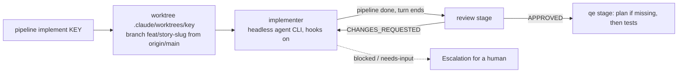

# Implement stage

Part of the [AI development pipeline](README.md). It starts the `implementer` agent for a story and drives it until the architecture review approves, so one command takes a story from merged markdown to reviewed code with tests being written.

```bash
node scripts/pipeline/pipeline.mjs implement PROMO-3                # run in the foreground
node scripts/pipeline/pipeline.mjs implement PROMO-5 --background   # several stories at once
node scripts/pipeline/pipeline.mjs status PROMO-3
```



1. **Worktree.** The story must be on the base ref (`origin/main`). The stage fetches it, then creates `.claude/worktrees/<key>` on `feat/<story-file-name>`, or reuses them on a later run. Each story gets its own checkout, so stories run in parallel and every hook and `git diff` sees only that story's work.
2. **Implementer.** The stage runs `pipeline start <KEY>` in the worktree, then starts the `implementer` agent there as a fresh headless process (`claude -p` by default; `PIPELINE_AGENT_CLI` and `PIPELINE_AGENT_CMD` work as for the other stages). It runs in `implement` mode: it can edit files and commit, but `git push`, `reset`, `stash`, `checkout`, `switch`, `rebase` and `worktree` are denied. Unlike the other pipeline agents it runs **with hooks enabled** (empty `PIPELINE_CHILD`), so its own Stop hook runs the review in the same session, exactly as when a person drives it.
3. **Review loop.** When the agent exits, the stage runs `pipeline done` if the agent didn't, then the same Stop dispatch the hook runs. If the agent's CLI already ran the hooks, nothing new happens. If it didn't (a custom command, or hooks not yet trusted), the review runs here. When the review requests changes, the stage starts the implementer again with the findings, up to `implement.maxRuns` (6). The review stage escalates on its own after 5 rounds.
4. **QE.** Approval starts test automation in the background in the worktree. If the story has no verified test plan yet, the QE stage writes one first.

The agent ends with `AGENT_RESULT: {"status": "done" | "blocked" | "needs-input", ...}`. `blocked` (a blocking story isn't merged) and `needs-input` (an open question that changes the design) stop the run and write `.agent-state/escalations/<KEY>-implement.md` in the main checkout.

## State, logs and metrics

- The main checkout's `.agent-state/stories/<KEY>.json` holds an `implement` section with the status (`running`, `approved`, `stopped`, `blocked`, `needs-input`, `escalated` or `failed`), the worktree, the branch and the number of runs. Review and QE state live in the worktree's own `.agent-state/`; `status` reads both.
- `--background` writes its log to `.agent-state/logs/<KEY>-implement-*.log`.
- Every implementer run is appended to `.agent-metrics/implement-runs.jsonl` in the worktree, so it's committed with the story's work.
- When the branch is merged, remove the worktree with `git worktree remove .claude/worktrees/<key>`.

## Commands

```bash
node scripts/implement/implement.mjs run PROMO-3 [--background] [--max-runs 6]
node scripts/implement/implement.mjs status [PROMO-3]
node scripts/implement/implement.mjs metrics [--json] [--since 2026-01-01]
```

Settings: `scripts/implement/config.json` (`implement.worktreeDir`, `implement.maxRuns`, `implement.timeoutSec`, `agent.models.implementer`).
