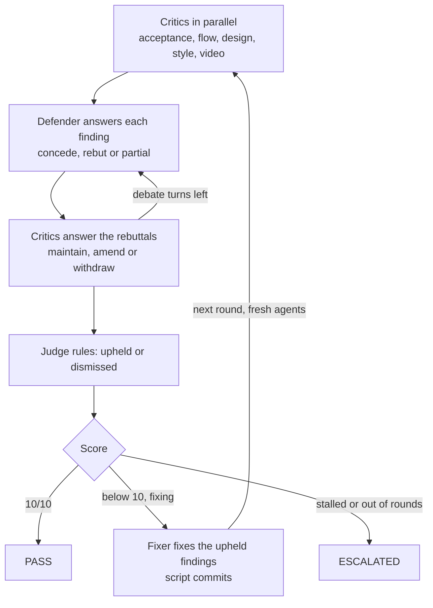

# PR check stage

An extra-large adversarial review of a pull request against its story. Critics argue that the PR falls short, a defender argues that it doesn't, and a judge rules. The script scores the round, a fixer fixes whatever the judge upheld, and fresh agents review again. This repeats until the PR scores **10/10** or the loop escalates to a human.

It checks four things, plus video evidence:

| Lens | Agent | Runs when | Checks |
| --- | --- | --- | --- |
| Acceptance criteria | `pr-check-acceptance` | always | every rule and acceptance criterion in the story is implemented and tested |
| Flow | `pr-check-flow` | always | the end-to-end journey (UI, API, events, data) matches the story's flow, including sad paths |
| UI design | `pr-check-design` | frontend stories (`[FE` in the title, a mockup under `product-research/mockups/<KEY>-*`, or changed Razor/CSS/WebApp files) | layout, components, states and copy match the mockup and the design system |
| Code style | `pr-check-style` | always | the code follows `AGENTS.md`, `.editorconfig`, the architecture docs and the implementer's conventions |
| Video evidence | `pr-check-video` | a video was found | frames show the journey working, with no error banners, 500s, blank screens or broken layouts |

## Running it

```bash
npm run pr-check -- run --pr 42                 # review PR 42 (checked out) and fix it until 10/10
npm run pr-check -- run --pr 42 --no-fix        # one report-only round; the PR doesn't need to be checked out
npm run pr-check -- run --story PROMO-3         # the current branch against a story, no PR needed
npm run pr-check -- run --pr 42 --videos test-results,https://example.com/demo.webm --comment --push
npm run pr-check -- status [pr-42]
npm run pr-check -- resume [PROMO-3|pr-42] [--force]   # continue checks that died
npm run pr-check -- metrics [--json] [--since 2026-01-01]
```

Or ask the `pr-check` agent (Copilot or Claude Code) to check a PR; it runs the same command and summarizes the report.

| Option | Default | Meaning |
| --- | --- | --- |
| `--pr <n>` | none | PR to check. Metadata comes from `gh`, or the GitHub API with `GITHUB_TOKEN`/`GH_TOKEN` |
| `--story <KEY>` | from the PR branch, title, body, or the active story | the story the PR is held to |
| `--base <ref>` | the PR base, else `PIPELINE_BASE_REF` | what the diff is taken against |
| `--videos a,b` | links in the PR description, else `test-results/` | video files, folders or URLs |
| `--no-fix` | fix | report only, one round |
| `--max-rounds <n>`, `--debate-turns <n>` | 6, 2 | loop limits |
| `--comment`, `--push` | off | post the report on the PR; push the fix commits |
| `--json` | off | print `result.json` instead of the report |
| `--resume` | off | continue the interrupted run of the same check from its last saved round |

Exit code 0 means PASS (10/10); anything else is FAIL or ESCALATED. Fix mode needs the PR branch checked out at the PR head with a clean working tree; `--push` is skipped for PRs from forks. report-only mode reviews a PR that isn't checked out in a temporary detached worktree.

## Runs automatically from the Stop hook

The check is the last stage of the agent Stop hook, after `review` and `qe`. When the implementation agent stops after `pipeline done` and the architecture review has approved the code on disk:

1. The hook starts a background waiter and tells the agent so; the agent can finish its turn.
2. The waiter waits for QE to verify the tests for that exact implementation (`hook.waitForTestsMin`, checking every `hook.pollSec`). If QE ends without verifying them (a product bug, an escalation), or the code changes, it stops without checking.
3. It runs one report-only round against the story (no PR needed; uncommitted work counts). The agent is the fixer, so nothing is committed over its work.
4. On the agent's next stop (or in the next session's start-up context) a failing result blocks with the open findings and the report path, once more if nothing changed, and then says so once. A pass is one notice.

Fixing the findings changes the code, so the review runs again, then QE, then the PR check. After `hook.maxRuns` failing checks for a story the hook escalates to a human (`.agent-state/escalations/<KEY>-pr-check.md`) instead of checking again; a pass resets the count, and so does `pipeline start`.

Hook runs are recorded in `.agent-metrics/pr-checks.jsonl` in the working tree, so they are committed with the story and feed the lessons like any other check. All of their findings are round-1 findings, so they teach the implementer.

`PR_CHECK_SKIP=1` (or `"enabled": false` under `prCheck.hook` in `scripts/pr-check/config.json`) turns the hook off; `PIPELINE_DISABLE=1` turns off every stage. The hook's settings:

| Setting | Default | Meaning |
| --- | --- | --- |
| `requireTests` | true | wait for QE to verify the tests first |
| `waitForTestsMin`, `pollSec` | 180, 20 | how long and how often the waiter checks on QE |
| `maxRuns` | 3 | failing checks per story before escalating |
| `codeAgents` | `implementer` | subagents whose `SubagentStop` triggers the check (main-session stops always do) |

`npm run pr-check -- status <KEY>` shows the last result.

## Interrupted checks

- **Stop-hook checks:** the waiter records its pid and boot in the story state. If it dies (crash, kill, reboot), the next session start, Stop or `pr-check resume` starts it again for the same code, or marks it `stale` if the code has changed. After `recovery.maxAttempts` (3) restarts, with growing delays, it is marked `crashed` and escalated; `resume <KEY> --force` retries it.
- **Manual checks (`run`):** the run keeps `.agent-state/pr-check/<id>/progress.json` up to date with its flags, its process and, in fix mode, the loop state after each critique and fix. The next session start lists interrupted runs, and `pr-check resume` (or `pipeline resume`) restarts each with `run --resume` in the background. It continues after the last finished round; a fix that was cut short runs again on the changes it left (a dirty tree is allowed for this), unless its commit was already made. Report-only runs are one round, so they start over. A run that fails rather than dies (bad flags, a dirty tree) is not resumed.

## The loop



Every agent call is a new headless process, so each round starts with a clean context. Critics see the previous round's upheld findings and re-raise any that are not fixed, under the same id.

**Scoring is done by the script, not the judge**, so no agent can talk its way to 10:

- An upheld finding caps its lens: blocking at 6, major at 8, minor at 9. The judge's lens score can only lower that.
- A finding the judge didn't rule on stands unless its critic withdrew it.
- Coverage gaps the judge finds without a finding (`<lens>-coverage-<n>`) count as upheld.
- A critic that fails to return a result scores its lens 0.
- The PR's score is the lowest lens score. 10 means nothing was upheld.

The loop escalates (`.agent-state/escalations/<id>-pr-check.md`) when the round limit is reached, when the same finding is upheld three rounds in a row, when the fixer says it can't fix any upheld finding without a human decision, or when the fixer changes nothing two rounds in a row.

## Videos

Videos come from `--videos`, else video links in the PR description (direct `.webm`/`.mp4`/`.mov`/`.mkv` links and GitHub `user-attachments`), else Playwright's `test-results/`. Each is turned into up to 48 frames (one per second at most): with `ffmpeg` when installed, otherwise by playing the file in Playwright's Chromium and screenshotting it. Chromium reads WebM, which is what Playwright records. A video that can't be read is listed in the report and handed to the video critic as an evidence gap.

## Models

The judge and critics run on the largest models. Defaults are in `scripts/pr-check/config.json` per CLI:

| Role | Claude Code | Copilot CLI |
| --- | --- | --- |
| Judge | `opus` | `claude-opus-5.5` |
| Acceptance, flow, design, video critics, fixer | `opus` | `claude-opus-5.5` |
| Defender | `opus` | `claude-sonnet-5.5` (a different model from the critics, so the debate isn't one model arguing with itself) |
| Style critic | `sonnet` | `claude-sonnet-5.5` |

Every model must be allowed by `agent.allowedModels` in `scripts/pipeline/config.json` (currently `opus`, `sonnet` and `haiku`, or the CLI id one of them maps to in `agent.modelIds`); see [qe.md](qe.md#models). Override one role with `PR_CHECK_MODEL_<ROLE>`, for example `PR_CHECK_MODEL_JUDGE=sonnet`.

## Files

Each run writes to `.agent-state/pr-check/<id>/` (`<id>` is `pr-<n>`, or the story key):

- `result.json` and `report.md`: the verdict, scores per round and lens, open findings with fixes, findings resolved during the loop, video evidence and what was not checked.
- `context/pr.md`, `context/frames.json` and `videos/`: what the agents were given.
- `round-<n>/`: `diff.patch`, every prompt and agent output, `debate.json` (each finding with its full thread), `coverage.json`, and `rulings.json`.

Every round is appended to `.agent-metrics/pr-checks.jsonl`, which `metrics` and `pipeline metrics` summarize. Each record keeps the upheld findings (id, lens, severity, title, detail, requirement, evidence, and `repeat` when the finding survived a fix round) and the findings the judge dismissed, with the judge's reason. Commit it with the work it describes, like the other metrics.

## How agents improve

The PR check feeds the shared lessons process (`node scripts/qe/qe.mjs lessons`, weekly in `qe-lessons.yml`, see [qe](qe.md#auto-improvement)). From `pr-checks.jsonl` it learns:

| Lessons file | Learns from | Category |
| --- | --- | --- |
| `implementer.md` | findings upheld in round 1, against the code as it was written | `pr-check-<lens>` |
| `pr-check-fixer.md` | findings upheld again after the fixer had a round to fix them | `not-fixed` (subtype = lens) |
| `pr-check-<lens>.md` (each critic) | its findings the judge dismissed (false positives) | `dismissed-finding` |

A mistake that recurs in 3 or more stories becomes a rule, proposed in a pull request; rules are strengthened, retired or reverted with the same measurements as every other agent. Each PR check agent gets its own lessons file appended to its prompt, the fixer also follows `implementer.md`, and the implementer reads `implementer.md` before it starts, so the next story avoids what the PR check caught in the last ones.

## In CI

`.github/workflows/pr-check.yml` runs a report-only check (`--no-fix --comment`) when a PR gets the `ai-pr-check` label, or on demand. It needs the chosen agent provider's credential (`ANTHROPIC_API_KEY` by default; see [CI setup](setup.md#ci) for Copilot, Codex and other CLIs). Fixing stays local, where a person can watch the loop and review its commits. For PRs from this repository, CI commits the run's new `.agent-metrics/*.jsonl` records to the PR branch (with `GITHUB_TOKEN`, so the push does not re-trigger workflows), and they count toward lessons once the PR merges. Fork PRs only get them in the run artifact.
