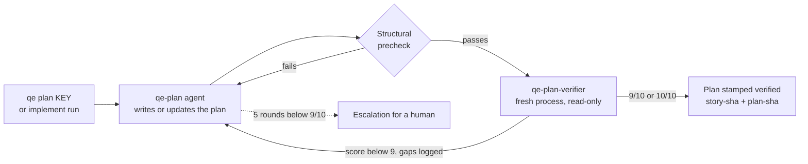
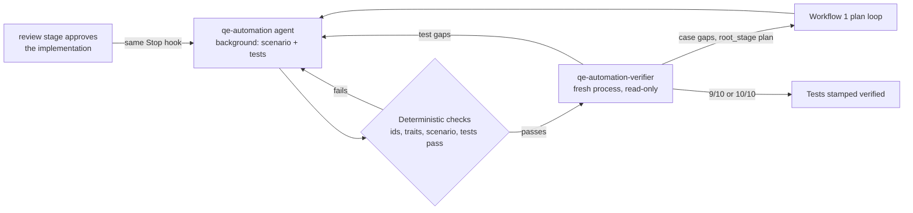

# QE stage

Part of the [AI development pipeline](README.md). Agents turn each user story into a verified integration test plan, and, once the implementation of a story is architecture-approved by the [review stage](review.md), into verified automated tests. Every artifact an agent produces is checked by a separate verifier agent that starts with a clean context and loops until it scores at least the required score (9/10, `loops.requiredScore`). Every denial is logged, and recurring denials become lessons that the agents read on their next run.

The stage CLI is `scripts/qe/qe.mjs`; settings are in `scripts/qe/config.json`.

## Workflow 1: story to test plan



- Output: `tests/plans/<story-slug>/_index.md` (the slug is the story's original file name, kept in its issue metadata) plus one `TC-<KEY>-NN-<slug>.md` per case, covering every happy and sad path (see [tests/plans/README.md](../../tests/plans/README.md)).
- The runner owns the index front matter. `story-sha` records the story text the plan was written for (the cached ticket's text, so it stays the same after the move to the board) and `story-issue` links the story's issue. When the story changes on the board, the plan becomes stale and the agent gets the story diff and updates the affected cases in place, keeping the ids of the others stable. The diff comes from the ticket cache, which keeps every version it fetched (`.agent-state/board/<KEY>/history/`), or else from the issue's edit history.
- Every case file starts with a `## Why` section: the requirement or risk it protects and why it sits at its layer. The plan agent's result also lists what it deliberately left out and why. Both go to the [decision log](#decision-log), not to the verifier.
- The verifier sees only the story and the plan. It never sees the planner's reasoning in its own context; the `## Why` sections are part of the plan it reads.

## Workflow 2: implementation to automated tests



1. The implementation agent runs `node scripts/pipeline/pipeline.mjs start <KEY>` and, when the line of work is complete, `node scripts/pipeline/pipeline.mjs done`.
2. When its turn ends, the dispatcher runs the review stage first. The QE stage runs only once the review has approved the current implementation (`review.approvedHash` matches), then starts the automation loop in the background and lets the agent finish. If the implementation changes again, the next approval re-runs automation in update mode, so the tests follow the corrected code.
3. The automation loop writes `testing/scenarios/<key>/scenario.yaml` and tests whose names carry their case ids, runs them, and loops with the automation verifier until it scores at least 9/10. If the tests show that the implementation contradicts the plan, the run stops with a `product-bug` escalation instead of weakening the tests.
4. Every recorded Playwright test also captures labeled keyframes (screenshots at each step, demo checkpoint and the final or failure state; see the `feature-demo-video` skill), listed in `artifacts/e2e-videos/manifest.json`. They are generated in the automation loop's deterministic checks (`precheckAutomation` in `scripts/qe/lib/workflows.mjs`), which run the story's Playwright tests with `E2E_KEEP_VIDEOS=1` because passing tests otherwise keep no video or keyframes. When that run fails, the feedback to the automation agent includes each failed test's error and keyframe paths. When the tests pass, the verifier gets every test's keyframes and checks that the screen matches each case (`visual-mismatch`). Only a manifest written by that run is used.

## Where it hooks in

The [dispatcher](README.md#lifecycle-events) calls the QE stage on these events:

| Event | What the QE stage does |
| --- | --- |
| `story-start` | reports the story's test plan state |
| `session-start` | resumes plan and automation runs that died; test plan and automation state of the active story, open product bugs, stale plans |
| `stop` | after review approval: starts automation in the background, or resumes it if its run died |
| `post-commit`, `post-merge` | nothing by default; with `git config qe.autoPlan true`, the plan loop in the background for stories added or changed |
| `pre-push` | `qe check`: existing plans and tests for touched stories are verified and current (a story with no plan yet passes). A push touches a story through its plan or scenario folder, tests carrying its case ids, or its key in the branch name or a commit message; stories are checked against their cached ticket (fetched when missing) |
| pull request | `qe-check.yml`, called from `ai-pipeline.yml` |
| manual (local, or `workflow_dispatch`) | `qe-lessons.yml`: `calibrate`, `metrics`, `lessons` (opens a PR) |

Adding or changing a story never starts an agent: run `node scripts/qe/qe.mjs plan <story>` (or `--stale`) yourself; `qe plan <KEY>` re-checks the issue first. Opt in to automatic planning with `git config qe.autoPlan true`: `board fetch` then plans every story it brings in changed (commits no longer do, since stories are not files in the repository); opt in to lessons runs after merges with `git config qe.autoLessons true`. Bypass the pre-push gate once with `QE_SKIP=1 git push`; CI still enforces it. `QE_REQUIRED_SCORE` overrides the 10/10 bar (for experiments only).

## Verifier loops

- Each round starts a new verifier process whose prompt holds only what it needs: the story and plan for plans; the case files, the tests and the scenario for automation. It cannot see the producer's reasoning or earlier verdicts.
- Cheap deterministic checks run before any verifier call (front matter, sections, happy and sad cases, index lists every id; every case has a test, no orphan ids, `[Trait("Story", ...)]`, scenario validates, tests pass).
- A verdict passes at the required score (`loops.requiredScore`, 9) or above. Gaps listed with a passing score are minor; they are logged in the metrics but don't block. A lower score without gaps counts as an unexplained gap. Gaps on a failing verdict go back to the producer as its next task.
- Automation gaps the verifier traces to the case itself (`root_stage: plan`) are sent to the plan loop and attributed to the plan agent in the metrics.
- After 5 rounds below the required score, the loop stops and writes `.agent-state/escalations/<KEY>-<stage>.md`, which the next agent session is told about.

## Crash recovery

A loop saves its round and the feedback for that round in the story state before each round. If the machine crashes or the run is killed, the state still says `running` (or `starting`, or `queued` for the rest of a plan batch) but its process is gone. The run is resumed in the background at the saved round, with the saved feedback and a note that the work on disk is from the interrupted run:

- on the next session start (any interrupted story) or Stop hook (the active story);
- by `node scripts/pipeline/pipeline.mjs resume [KEY]` (or `qe.mjs resume`);
- while `implement run` waits for the tests of a story.

Automation for code that has changed since the run started is dropped, and the Stop hook starts a fresh run for the new code. Each run is resumed up to `recovery.maxAttempts` times (in `scripts/pipeline/config.json`, default 3), waiting `recovery.backoffSec` (60 s) and then twice as long before each retry, so a run that crashes on start does not loop. After that its status is `crashed` and an escalation is written; fix the cause, then run `pipeline resume KEY --force`.

The lessons and factory retro run (`qe lessons`, see [Auto-improvement](#auto-improvement)) is not tied to a story. It records itself in `.agent-state/lessons-run.json` (pid, boot, phase, branch) and holds `.agent-state/locks/lessons.lock`, and it writes `lessons-last.json` only when it ends, so a run that died is still due. The next `qe lessons` (including `--if-due`) starts it over after removing the dead run's worktree and branch; if it had already committed, it only pushes and opens the PR. Session start, `qe resume` and `pipeline resume` (without a story) restart it in the background with the same backoff, and escalate it after `recovery.maxAttempts` (`.agent-state/escalations/lessons-qe.md`); `resume --force` retries it.

## Observability

All results are appended to `.agent-metrics/*.jsonl` (architecture reviews are in `arch-reviews.jsonl`, see [review.md](review.md); PR checks are in `pr-checks.jsonl`, see [pr-check.md](pr-check.md)), which are committed with the plans and tests they describe (`merge=union` keeps every record across branches):

| File | One record per |
| --- | --- |
| `verifier-runs.jsonl` | verifier round: stage, story, round, score, passed, producer and verifier prompt versions |
| `verifier-denials.jsonl` | gap: category, subtype, case, detail, location, `root_stage`, `attributed_agent` |
| `precheck-failures.jsonl` | failed deterministic check |
| `calibration.jsonl` | audit of a past 10/10 verdict (`agreed`, or each gap the verifier missed) |
| `decisions.jsonl` | agent decision and its reasons (see [Decision log](#decision-log)) |

`node scripts/qe/qe.mjs metrics` (or `--json`; `pipeline metrics` combines every stage) reports denial rates, first-round pass rates, rounds to 10/10, denials by category and agent, the trend for each prompt version (a version is the hash of the agent file plus its lessons), cross-stage denials and calibration misses.

### Decision log

`.agent-metrics/decisions.jsonl` records why each agent decided what it did, at the four points where the factory can go wrong. One record per decision: `ts`, `stage`, `story`, `round`, `agent`, `agent_ver`, `subject` (the agent whose work is judged), `decision`, `reason` (the agent's own summary) and `items`, each with its own `reason`. Text is capped at 1,000 characters and stripped of control characters.

| `stage` | `decision` | Why it was decided | `items` |
| --- | --- | --- | --- |
| `plan` | `plan-written` | the plan agent's summary of how it split the story; `excluded` lists what it left out and why | each case: id, title, type, layer, `covers` and its `## Why` |
| `plan-verify`, `automation-verify` | `approved`, `denied` | the verifier's summary and `score` | each gap: case, category, subtype, location, `root_stage`, `subject` (the agent it is attributed to) |
| `review` | `approved`, `changes-requested` | the reviewer's summary (`architecture-reviewer`, or `arch-review-agent` for the policy pack with `policy_decision`) | each finding: severity, category, `rule`, `repeat`, file, line, `fix` |
| `automation` | `product-bug` | the automation agent's summary of why the implementation, not the test, is wrong | each bug: case, expected, actual, location |

Plan decisions are logged each round that passes the structural check, so each pairs with that round's verifier decision. Calibration audits are not logged here (they go to `calibration.jsonl`).

## Auto-improvement

`node scripts/qe/qe.mjs lessons` reads the metrics and, for each of `qe-plan`, `qe-automation`, `qe-plan-verifier`, `qe-automation-verifier`, `implementer` (whose denials are the blocking findings in `arch-reviews.jsonl`, see [review](review.md#how-the-implementer-improves), the implementation bugs the integration tests found (`product-bug` in the decision log) and the findings the PR check upheld in round 1), and the PR check fixer and critics (from `pr-checks.jsonl`, see [pr-check](pr-check.md#how-agents-improve)):

- **adds** a rule when a denial category recurs in 3 or more stories and no rule covers it;
- **strengthens** a rule when its category keeps recurring in 3 or more stories after the rule was added;
- **retires** a rule when its category has not recurred for 10 stories;
- **reverts** a rule when the denial rate for its category did not drop after it was added.

The `qe-lessons` agent writes the rules into `.github/agents/lessons/<agent>.md` (at most 15 each), and the command opens a pull request, so every change to agent behavior is reviewed like code. Each rule carries a marker with its category and date, which is what makes the retire and revert measurements possible. The lessons file is appended to the agent's prompt on every run, and it is part of the prompt version, so the metrics show whether a change helped.

The same run holds a **factory retro**: it digests the decision log since the last merged lessons PR (or the last `lessons.retro.windowDays`) into the four questions (why the plan has these cases and which of them later failed or caught bugs, why reviews blocked or approved the implementer, why the automation verifier denied the tests, and why the tests failed the implementation) and hands it to the `qe-lessons` agent. QE verifier evidence mainly improves the QE agents; review and product-bug evidence mainly improves the implementer. When the cause is not something a lessons rule can fix, the agent may also edit the paths in `lessons.retro.allowedPaths` (agent definitions, docs, the story template, the policy pack); edits anywhere else are discarded, and each change it makes is listed under "Proposed factory changes" in the PR with its evidence. The retro runs whenever the window holds new decisions, even when no lessons threshold is reached.

Verifiers improve through calibration: `qe calibrate` re-audits recent 10/10 verdicts with a stricter auditor (optionally a different model, `agent.models.audit`), and gaps the verifier missed become lessons for that verifier.

Tune thresholds, round limits, models and categories in `scripts/qe/config.json`.

## Speed

- **Test run in the precheck.** Each .NET test project is built once (`precheck.dotnetBuild`, one after another, because they share dependencies), then all of them run at the same time with `--no-build`. The Playwright specs run alongside them.
- **Shared test stack.** The machine has one teststack, and loading a scenario wipes its data. So the e2e part of the precheck holds a lock in git's common dir (`.git/pipeline-locks/teststack.lock`), which every worktree shares. Stories in different worktrees write and build their tests in parallel and take turns only on the e2e run, unless they run on [stack slots](#stack-slots).

### Stack slots

When `implement run` works on several tickets at once (`IMPLEMENT_PARALLEL` > 1, which it sets from `--parallel`; or `QE_USE_SLOTS=1`) and `useSlots` is on (`scripts/qe/config.json`, default `true`; `QE_USE_SLOTS=0` turns it off), a story's e2e run leases an isolated stack slot instead of waiting for slot 0 (`scripts/qe/lib/slots.mjs`): `slots.mjs lease --owner qe-<KEY>`, `testing/teststack --slot <n> up` from the story's worktree (it builds that worktree's code), the specs with `TESTSTACK_SLOT=<n>` and `TESTSTACK_URL` set to the slot's WebApp, then `down` and `release`, even when the run fails. The specs follow the slot through `e2e/teststack/ports.ts` (`WEBAPP_URL`, `IDENTITY_URL`, `CATALOG_URL`, `BASKET_GRPC_URL`, `port(name)`), `playwright.teststack.config.ts` (its `baseURL`) and `loadScenario` (which runs `testing/teststack` with `TESTSTACK_SLOT`). The run stays on slot 0, behind the lock, when any of its specs names a slot-0 host port literally (`localhost:18xxx`, `host.docker.internal:18xxx`; the older specs do), when no slot is free, or when the slot's stack does not come up. The automation agent is told to build URLs from `ports.ts`, so new specs run on any slot. How many slots exist is `TESTSTACK_SLOTS`, which `--parallel auto` sizes from Docker's memory ([implement](implement.md#resources)).
- **Models.** The writers and verifiers each have a model in `agent.models`: `plan`, `automation`, `verifier` and `audit`. Test writing (`automation`) uses `sonnet`: it is a long build-and-fix loop where speed matters, and the automation verifier still scores every round. `null` means the CLI's default model.

## Models

Models are named by alias. `agent.allowedModels` in `scripts/pipeline/config.json` lists the allowed ones, currently `opus`, `sonnet` and `sol` (Opus 5.5 and Sonnet 5.5 on every CLI, Sol 6.1 as `gpt-6.1-sol` on Copilot only). Any other value fails when the config loads. `agent.modelIds` maps each alias to each CLI's own model id (`claude-opus-5-5` for Claude Code, `claude-opus-5.5` for Copilot, and so on). With `agent.strictModels` (on), a run without a model uses `agent.models.default` (`sonnet`) and a CLI with no id for an alias is refused rather than falling back to its own default model, so Codex, which has no ids, cannot run. `PIPELINE_MODEL_OVERRIDE=<alias>` forces one allowed model for every agent, for experiments. To allow another model, add its alias to `allowedModels` and its id for each CLI to `modelIds`. See [models](models.md) for the per-CLI view, discovery and `npm run models:check`.

## Commands

```bash
node scripts/qe/qe.mjs status [PROMO-3]
node scripts/qe/qe.mjs plan PROMO-3 | --stale | --all [--force] [--background]
node scripts/qe/qe.mjs automate PROMO-3 [--skip-tests] [--background]
node scripts/qe/qe.mjs resume [PROMO-3] [--force]   # resume runs that died (and, without a story, the lessons run); --force also escalated ones
node scripts/qe/qe.mjs check [--all] [--changed-from origin/main]
node scripts/qe/qe.mjs metrics [--json] [--since 2026-01-01]
node scripts/qe/qe.mjs calibrate [--stage plan|automation] [--sample 3]
node scripts/qe/qe.mjs lessons [--dry-run] [--local] [--if-due] [--resume]
npm run test:pipeline                          # all pipeline tests (fake agent, no LLM)
```

Background runs log to `.agent-state/logs/`.
