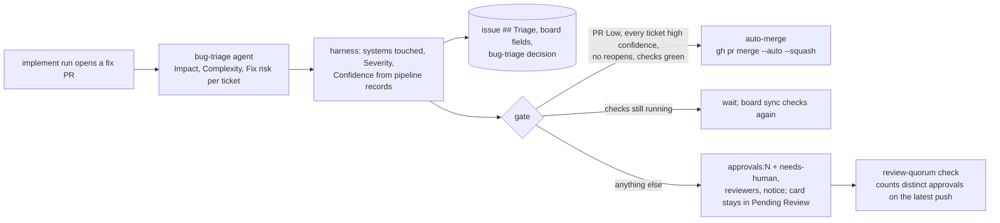

# Review gate for bug-fix PRs

Part of the [AI development pipeline](README.md). The gate starts only **after the pipeline publishes a fix PR**: a single-ticket bug PR (`implement run BUG-7 --pr`) or a bug-epic group PR ([PR groups](implement.md#bug-epics-pr-groups)). Implementation, verifier pairs, architecture review, QE, the PR check and the grouping of bugs run exactly as before; feature stories and feature epics are never gated.

The code is in `scripts/review-gate/`; its settings are `implement.reviewGate` and `implement.autoMerge` in `scripts/implement/config.json`, and the board field names are `board.fields` in `scripts/board/config.json`.



## Assessment

Right after the runner opens the PR, it runs `node scripts/review-gate/review-gate.mjs publish --pr <url> --tickets K1,K2 --base <ref>` from the PR's worktree (`scripts/implement/lib/post-publish.mjs`). Like the board events, it is a separate process: a failure is logged and never changes a ticket's outcome.

1. **Triage agent.** `bug-triage` (`.github/agents/bug-triage.agent.md`) is a fresh, read-only run, not the implementer. It gets every ticket's text, the systems the PR touches and the PR's actual diff, and rates each ticket on three separate fields, each **Low / Medium / High / Severe**, with a reason: **Impact** (what the bug does to users or data), **Complexity** (the size and entanglement of the fix) and **Fix risk** (the chance the fix breaks something else). It also names floor categories the fix touches (`auth`, `payments`, `migration`, `security`), its own confidence (0-100) and a one-line summary. An invalid result goes back once with the errors; a ticket that is still not rated counts as not assessed (and its PR can never auto-merge). Model: `agent.models.bugTriage` (`opus`: the ratings decide whether a PR merges without a person, and it runs once per PR).
2. **Systems touched.** Every changed file maps to its project or service (`reviewGate.systems`): Catalog.API, Basket.API, Ordering.API (with Ordering.Domain and Ordering.Infrastructure), Identity.API, Webhooks.API, Promotions.API, WebApp (with WebAppComponents), WebhookClient, OrderProcessor, PaymentProcessor, the mobile clients. Shared infrastructure counts as its own systems: **Integration events** (any `IntegrationEvents/Events/` folder, the contracts), **EventBus** (with EventBusRabbitMQ and IntegrationEventLogEF), **ServiceDefaults** (with `src/Shared`), **AppHost** and **Build** (the root build files). Tests, e2e specs, docs and metrics (`reviewGate.ignore`) touch no system; anything else is **Other**. In a group PR each ticket's files are the diff of its own `<KEY>: Merge into <group branch>` commit.
3. **Severity** (computed by the harness, never by the agent; `scripts/review-gate/lib/severity.mjs`):
   - base = max(Impact, Fix risk). Complexity is shown but feeds into Fix risk instead of counting directly;
   - a floor of **High** (`reviewGate.floor`) when the ticket's files hit an override path (`src/Identity.API/**`, `src/PaymentProcessor/**`, `**/Migrations/**`) or the agent named a floor category;
   - **+1 level per human reopen**, capped at Severe, stored apart so it can be recomputed and explained: "Impact Medium, Fix risk Low → Medium, +1 reopen → High".
4. **Confidence (0-100)** from the records the pipeline already keeps (`lib/confidence.mjs`). High confidence means all of: **no QE bug-fix cycles** (`bugFixCycles` = 0, QE's tests passed on the first try), every **verifier pair approved in ≤ 2 rounds** (`subtask-runs.jsonl`), the **PR check reached 10/10 in ≤ 2 rounds** (`pr-checks.jsonl`), **no edits outside `owns`**, and **CI green** (`gh pr checks`), plus a score of at least `confidence.highMin` (85). Each of the five criteria is worth 16 points; the agent's own estimate is worth the other 20 (`agentWeight` 0.2), so a doubtful agent can block high confidence but never create it. A criterion without a record (no PR check yet, a story run without verifier pairs) earns nothing and is not met; pending CI earns half.
5. **PR severity** = max ticket severity, **+1 level** when the PR touches **3 or more systems** (`manySystems`), and at least **High** (`sharedFloor`) when it changes shared infrastructure or an integration-event contract. The **PR class** is the PR severity, plus `+shared` for shared infrastructure or a contract; the approvals policy and the retro group PRs by it.

### Where it is recorded

| Where | What |
| --- | --- |
| Issue body, `## Triage` | Per ticket: each field with its reason, Severity with its explanation, Confidence with the signals that were not met, the systems, the floor, the human reopens, and a hidden copy of the data (`<!-- bug-triage:data:... -->`). The issue is the source of truth: reopens and bumps are read back from it on any machine. The section sits outside the story's source markers, so agents never read it as part of the story, and `board publish` keeps it |
| Board fields | **Impact**, **Complexity**, **Fix risk**, **Severity** (single-select Low / Medium / High / Severe; Severity is derived), **Confidence** (number) and **Human reopens** (number), created by `board setup` (names in `board.fields`) |
| `.agent-metrics/decisions.jsonl` | One `stage: "bug-triage"` decision per assessment: `pr`, `stories`, `pr_severity`, `pr_class`, `systems`, `shared`, `contract`, `ci`, and per ticket in `items` the three ratings, `severity` with its `severity_base` and `severity_bump`, the floor, `confidence`, `high_confidence`, `agent_confidence`, `reopens` and `systems`. Written in the main checkout (the PR branch gets no new commits for it), like the PR-group outcomes |
| `.agent-state/review-gate/pr-<n>.json` | This machine's copy of the assessment (`review-gate status`) |

The agent's usage is recorded like every other run (stage `bug-triage` in `token-usage.jsonl`, see [costs](costs.md)).

## The gate

`lib/gate.mjs` decides from the assessment, then applies the decision to the PR.

| Decision | When | What happens |
| --- | --- | --- |
| **auto-merge** | the PR severity is **Low**, every ticket has **high confidence**, no ticket has a **human reopen**, the PR's **checks pass**, and `implement.autoMerge.enabled` | until the gate's auto-merge step lands, reviewed like any other PR |
| **wait** | everything qualifies but the checks are still running (or none reported yet) | the notice says so |
| **review** | anything else: Medium, High or Severe, low confidence, a human reopen, failing checks, a ticket that was not assessed, auto-merge switched off | **1 required approval** (the [approvals policy](#approvals-policy) table; never fewer than 1), the labels `approvals:N` and `needs-human`, review requests, and the notice. The card stays in Pending Review |

Reviewers are requested from each ticket's **assignees**, or, for a ticket without one, the **CODEOWNERS** of the files it touches (`.github/CODEOWNERS`); never the PR's author. CODEOWNERS stay optional reviewers on every PR, and the team can bring in more reviewers themselves: the gate only sets the **number** of required approvals.

The **review notice** is one PR comment, edited in place. It has a row per ticket (the three fields, Severity, Confidence, systems), each ticket's reasoning and confidence signals collapsed, the PR severity with its explanation, and says exactly what triggered review, for example "**What triggered review:** BUG-7 is Medium (Identity.API; Impact Medium, Fix risk Low → Medium). BUG-3 and BUG-9 would have auto-merged." Its hidden marker (`<!-- review-gate:{...} -->`) carries the gate's state on the PR: the decision, the approvals, the triggers, the head it was assessed on and the "changes requested" reviews already counted as reopens.

A PR that needed people stays that way: later evaluations never auto-merge it, even if the trigger went away.

### Enforcement: the review-quorum check

GitHub rulesets set one approval count per branch, not per PR, so `.github/workflows/review-quorum.yml` enforces the count per PR. It runs on `pull_request` (opened, pushed, labeled, ...) and `pull_request_review` (submitted, edited, dismissed), and passes when approvals from **distinct people**, not the author, given on the **latest push** (an approval from before it is stale), reach the PR's `approvals:N` label. Each reviewer's latest approving or "changes requested" review counts; a comment does not change a verdict. A PR without the label, or with `approvals:0`, passes. The check runs `scripts/review-gate/quorum.mjs` from the **base branch**, so a PR cannot change how its own approvals are counted; changes to `.github/workflows/`, `.github/CODEOWNERS` and `scripts/review-gate/` are severity floor paths for the same reason.

**Making it required is a repository setting**, armando's call: Settings → Rules → Rulesets → the ruleset for `main` → "Require status checks to pass" → add `review-quorum`. Until then it is a visible check that nothing blocks on. `main` has no branch protection and no required approvals today; the gate does not change any repository setting.

## Approvals policy

`implement.reviewGate.approvals` maps a PR class to its required approvals: the entry for the class (`High+shared`), else for its severity (`High`), else `default`. Today every class needs **1**. A PR that does not auto-merge never needs fewer than 1, whatever the table says.

```json
"approvals": { "default": 1, "Low": 1, "Medium": 1, "High": 1, "Severe": 1 }
```

## Switches

| Switch | Effect |
| --- | --- |
| `implement.reviewGate.enabled: false`, or `REVIEW_GATE=0` | The gate does nothing; PRs stay as the pipeline opened them |
| `PIPELINE_NO_PR=1` (experiments) | No PRs, so nothing to gate |
| board inactive (no project, a fork, a test repo, `PIPELINE_BOARD=0`) | The gate does nothing |

## Commands

```bash
node scripts/review-gate/review-gate.mjs publish --pr <url> --tickets BUG-1,BUG-2 --base origin/main   # run by implement run
node scripts/review-gate/review-gate.mjs status [--pr <url>]
node scripts/review-gate/quorum.mjs <pr number> --repo owner/name    # what the review-quorum check runs
node scripts/board/board.mjs setup        # creates the triage fields on the board
```
