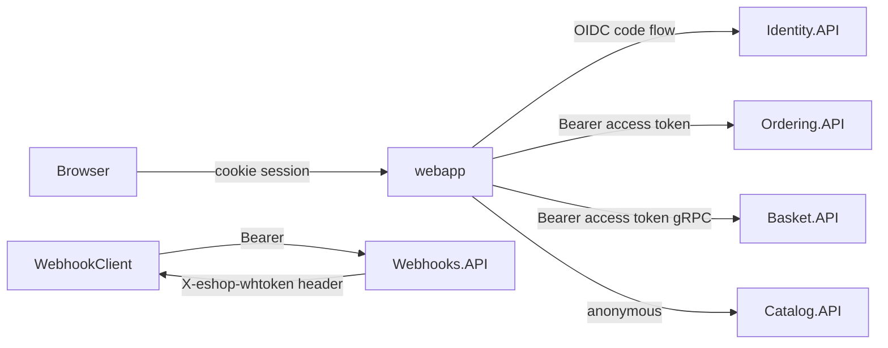

# Infrastructure, Security, and Operations

## 1. Orchestration with Aspire

`src/eShop.AppHost` is the single source of truth for topology.

| Resource | Type | Notes |
| --- | --- | --- |
| `redis` | Container | Parent-related to `basket-api` |
| `eventbus` | RabbitMQ container | `ContainerLifetime.Persistent` |
| `postgres` | `ankane/pgvector:latest` container | Persistent; hosts `catalogdb`, `identitydb`, `orderingdb`, `webhooksdb` |
| `identity-api`, `catalog-api`, `basket-api`, `ordering-api`, `order-processor`, `payment-processor`, `webhooks-api`, `webapp`, `webhooksclient` | .NET projects | Wired via `WithReference` (connection strings + service discovery) and `WaitFor` |
| `mobile-bff` | YARP | Routes configured in `Extensions.ConfigureMobileBffRoutes` |
| `foundry` (opt-in `UseFoundry=true`) | Microsoft Foundry | `chatModel` = gpt-4.1-mini, `textEmbeddingModel` = text-embedding-3-small, referenced by catalog-api and webapp |
| Ollama (code toggle `useOllama`) | Container | `llama3.1` chat, `all-minilm` embeddings |
| `aca` | Azure Container Apps environment | Deployment target for `aspire deploy` / `azd`; added only when TestStack mode is off |
| Docker Compose environment (`TestStack=true`) | Compose environment (`TestStack.cs`) | Replaces `aca` for the reproducible test stack; see below |

Other AppHost behaviours:

- `AddForwardedHeaders()` sets `ASPNETCORE_FORWARDEDHEADERS_ENABLED` for every project (needed behind ACA ingress).
- `ESHOP_USE_HTTP_ENDPOINTS=1` forces HTTP launch profiles (used by Playwright CI).
- Identity receives every client's callback URL, creating an intentional cyclic reference.

### TestStack mode

`TestStack=true` (set by `testing/teststack`) swaps the `aca` environment for a Docker Compose environment and applies compose-only customizations from `src/eShop.AppHost/TestStack.cs`. The rest of the model is shared. See [testing/README.md](../../testing/README.md).

- Every project uses its `http` launch profile.
- Each service and infrastructure container publishes a fixed host port (slot 0: webapp 18080, identity-api 18081, catalog-api 18082, basket-api 18083, ordering-api 18084, webhooks-api 18085, webhooksclient 18086, mobile-bff 18087, dashboard 18888, postgres 18432, redis 18379, eventbus 18672).
- Ports are emitted as compose variables (`${WEBAPP_HOST_PORT:-18080}`), so one generated compose file serves several isolated **slots**. Slot n adds 1000 × n to every port; `testing/teststack --slot <n>` exports the slot's values, and agents lease slots through `scripts/stack/slots.mjs`.
- Identity, the WebApp and the WebhookClient get browser-reachable URLs (`http://host.docker.internal:<identity port>` as issuer), so redirect URIs follow the slot.
- Identity, catalog and ordering start with their built-in seeding off (`Seeding__Disabled=true`); `testing/teststack` loads scenario data instead.

## 2. Service defaults (`eShop.ServiceDefaults`)

Every service calls `builder.AddServiceDefaults()`:

- OpenTelemetry logging, metrics (ASP.NET Core, HttpClient, runtime) and tracing (ASP.NET Core, gRPC, HttpClient, plus `Experimental.Microsoft.Extensions.AI` and the RabbitMQ activity source), exported via OTLP to the Aspire dashboard.
- Default health checks; `/health` and `/alive` are mapped **only in Development**.
- Service discovery and `AddStandardResilienceHandler()` on all `HttpClient`s.
- `AddDefaultAuthentication()` - JWT bearer validation against `Identity:Url`. `Identity:Audience` is set, but `ValidateAudience = false`, so any token from the authority is accepted by every API.
- `AddDefaultOpenApi()` - versioned OpenAPI docs with Scalar UI and OAuth security scheme.

## 3. Security model

| Area | Current state |
| --- | --- |
| Authority | Duende IdentityServer, in-memory clients/scopes, developer signing credential |
| Users | ASP.NET Core Identity in `identitydb`, seeded demo users |
| API authorization | Ordering and Webhooks: `RequireAuthorization()` on the route group. Basket: per-method via user claim. Catalog: **no authentication on any endpoint**, including create/update/delete |
| Token validation | Issuer validated; audience **not** validated (`ValidateAudience = false`) |
| Service-to-service | No mTLS or service identity; trust is network-based plus JWT where configured |
| Webhooks | Grant-URL `OPTIONS` handshake with shared token; outbound POST carries `X-eshop-whtoken` (no HMAC signature) |
| Secrets | Aspire generates DB/RabbitMQ passwords; `appsettings.Development.json` files contain placeholder local passwords |

## 4. Data ownership

| Store | Owner | Contents |
| --- | --- | --- |
| `catalogdb` | Catalog.API | `CatalogItem` (with `Embedding vector(384)`), `CatalogBrand`, `CatalogType`, outbox |
| `identitydb` | Identity.API | ASP.NET Identity tables |
| `orderingdb` | Ordering.API (OrderProcessor reads) | `ordering` schema: orders, order items, buyers, payment methods, card types, requests (idempotency), outbox |
| `webhooksdb` | Webhooks.API | Subscriptions |
| Redis | Basket.API | Baskets keyed by buyer id (ephemeral) |

Each service applies its own EF Core migrations and seed data on startup (`MigrateDbContextAsync` helper in `src/Shared`).

## 5. Observability

- Distributed tracing spans HTTP, gRPC, and RabbitMQ publish/receive (trace context propagated through message headers), so a checkout can be followed end-to-end in the Aspire dashboard.
- Structured logging via `ILogger` with event IDs in integration-event handlers.
- No custom business metrics (orders/min, payment failure rate, stock rejections) are emitted.

## 6. Build, test, CI

| Workflow | What it does |
| --- | --- |
| `pr-validation.yml` | `dotnet build eShop.Web.slnf` and `dotnet test` (unit + functional; functional tests spin up containers via Aspire/Testcontainers-style fixtures). A `teststack` job checks the generated compose file is current (`testing/teststack publish --check`) and validates the scenarios (`testing/teststack validate`) |
| `pr-validation-maui.yml` | Installs MAUI workloads and builds the mobile apps |
| `playwright.yml` | Runs Playwright E2E (`e2e/`: browse, cart, checkout, login setup) against the running AppHost |
| `lint.yml` | ESLint (JS/TS under `scripts/`, `e2e/`, root configs), markdownlint (`**/*.md`) and `dotnet format --verify-no-changes` (C#) on every PR; run locally with `npm run lint` |
| `ai-pipeline.yml` | Checks agent definitions are in sync and models are allowed, runs the pipeline script tests, and calls `qe-check.yml` |
| `qe-check.yml` | Reusable: `qe check` fails when an existing test plan or test suite of a touched story is unverified or stale |
| `qe-lessons.yml` | Manual: QE calibration, metrics and lessons; proposes lessons in a PR |
| `pr-check.yml` | Adversarial AI PR check against the story (see [pr-check](../ai-pipeline/pr-check.md)) |
| `pr-demo-video.yml` | Starts the test stack, records the PR's teststack specs and publishes the videos and API summary to the PR |
| `board-epic-assign.yml` | When an epic issue is (un)assigned, gives its open stories the same assignees |
| `graphify-cache-prune.yml` | Weekly: opens a PR that prunes unused graphify semantic-cache entries |

The AI workflows are described in [docs/ai-pipeline](../ai-pipeline/README.md).

Two Playwright configurations exist: `playwright.config.ts` runs `e2e/*.spec.ts` against the AppHost, and `playwright.teststack.config.ts` runs `e2e/teststack/*.spec.ts` (API and browser specs for auth, basket, catalog, ordering, the order lifecycle, the mobile BFF and webhooks) against the Docker Compose test stack with scenario data (`testing/scenarios/`). Every e2e test is recorded on video.

Test projects (approximate test-method counts): Ordering.UnitTests (40), ClientApp.UnitTests (40), Catalog.FunctionalTests (19), Application.UnitTests (17), Ordering.FunctionalTests (11), Basket.UnitTests (9), eShop.AppHost.UnitTests (5), Basket.FunctionalTests (2), Webhooks.FunctionalTests (2). There are no unit or functional tests for PaymentProcessor, OrderProcessor, Identity.API, or the RabbitMQ event bus; they are exercised only end to end by the teststack specs (`auth-identity-api`, `order-lifecycle`, `ordering-pipeline`).

## 7. Deployment

- Target: Azure Container Apps via the `aca` environment (`aspire deploy` / `aspire publish`, or `azd`).
- Postgres, Redis, and RabbitMQ run as containers by default; there are no Azure-managed equivalents (Azure Database for PostgreSQL, Azure Cache for Redis, Service Bus) configured in the AppHost.
- No IaC beyond what Aspire generates; no environment-specific (dev/test/prod) AppHost configuration.
